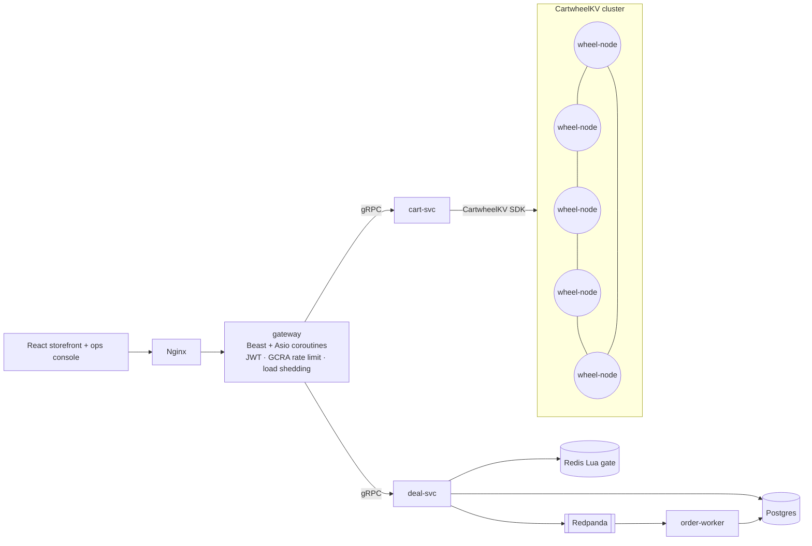

**English** | [中文](README.zh.md)

# Cartwheel

**A Dynamo-style distributed key-value store and a high-concurrency commerce stack, written in C++20.**

The 2007 Dynamo paper describes a shopping cart that must accept writes even
while servers fail and the network partitions. Cartwheel builds that system end
to end. **CartwheelKV** is a leaderless, quorum-replicated KV store with its own
LSM storage engine. On top of it run a shopping-cart service, a flash-sale
("lightning deal") pipeline that must never oversell, a C++ edge gateway, and a
React storefront with an operations console.

The cart and the deal inventory sit on opposite sides of the CAP trade-off, so
both models live in the same system:

| Data | Requirement | Mechanism |
|---|---|---|
| Shopping cart | Always writable, even during partitions (AP) | CartwheelKV: N/R/W quorum, sloppy quorum + hinted handoff, vector clocks, OR-Set CRDT merge |
| Deal inventory | Never oversell (CP) | Redis Lua atomic gate → Redpanda (Kafka) to absorb the spike → idempotent Postgres writes |


*The storefront after another writer changed the cart: the bracketed line came from the other window, nothing was overwritten. Real capture against the running stack.*

## Architecture



## Status

| Milestone | Scope | State |
|---|---|---|
| M0 | Toolchain, build system, overload primitives (GCRA limiter, jittered backoff, histogram, bounded pool), CI | ✅ |
| M1 | End-to-end skeleton: single node (DVV siblings), cart-svc (OR-Set CRDT), Beast/coroutine gateway, storefront, docker-compose | ✅ |
| M2 | LSM storage engine (WAL, skiplist memtable, SSTables, bloom filters, compaction) | |
| M3 | Distribution: consistent hashing, gossip, quorum, vector clocks, hinted handoff, Merkle anti-entropy, deterministic simulation | |
| M4 | Lightning-deal pipeline: Redis gate, Redpanda, order-worker, Postgres; gateway auth and rate limiting | |
| M5 | Storefront and ops console (hash ring, live QPS/p99, fault injection) | |
| M6 | Observability (Prometheus, Grafana, OpenTelemetry), k6 load tests, chaos experiments | |
| M7 | Helm/kind deployment, PRFAQ, runbooks | |

## Build

Prerequisites: CMake ≥ 3.25, Ninja, a C++20 compiler (Apple Clang 17 / Clang 18 / GCC 13), and
[vcpkg](https://github.com/microsoft/vcpkg) cloned to `~/vcpkg` or pointed to by `$VCPKG_ROOT`.

```bash
cmake --preset dev          # first run builds dependencies through vcpkg (gRPC takes a while)
cmake --build --preset dev
ctest --preset dev

cmake --preset tsan && cmake --build --preset tsan && ctest --preset tsan   # ThreadSanitizer
```

Presets: `dev` (Debug), `release` (RelWithDebInfo), `asan` (Address + UB), `tsan` (Thread).

## Run it

```bash
# local binaries (after the build above)
build/dev/src/kv/wheel-node &
CARTWHEEL_KV_TARGET=127.0.0.1:7100 build/dev/src/services/cart/cart-svc &
CARTWHEEL_CART_TARGET=127.0.0.1:7200 build/dev/src/gateway/gateway &
(cd web && pnpm install && pnpm dev)          # http://localhost:5173
scripts/e2e_smoke.sh http://127.0.0.1:8080    # idempotency, 20 concurrent adds, no resurrection

# or the whole stack in containers
docker compose -f deploy/compose/docker-compose.yml up -d --build   # http://localhost:8088
```

In the storefront, **Race two writers** fires two adds at the same instant: the store keeps two DVV
siblings, and the cart shows "Merged 2 concurrent versions" with both items kept.

## Documentation

- [Illustrated guide](docs/illustrated/README.md): walks one request at a time through the
  system, using traces captured from real runs.
- [Architecture decision records](docs/adr/)
