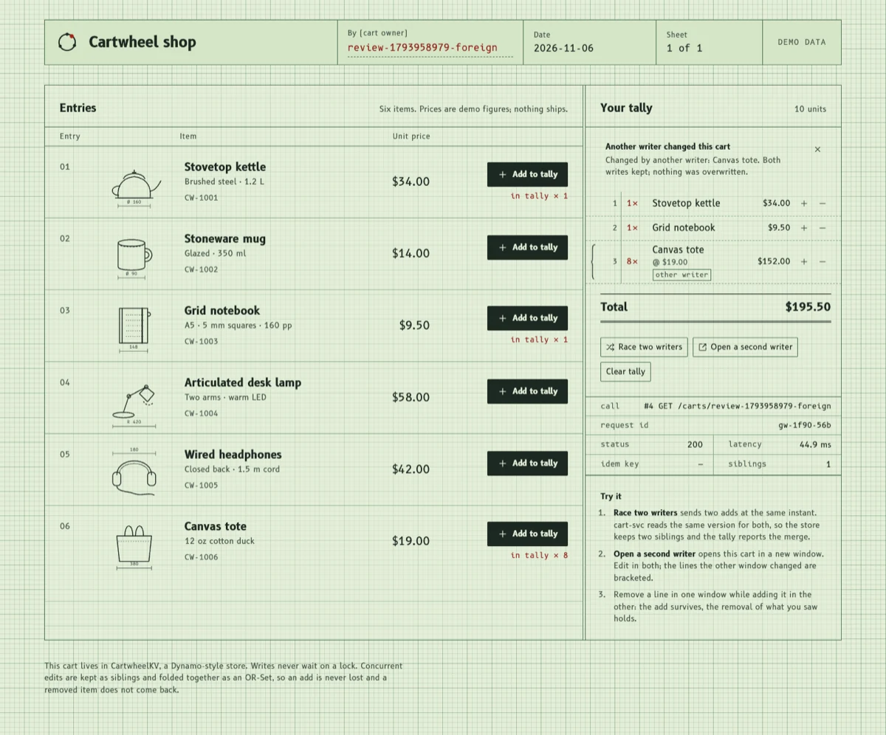
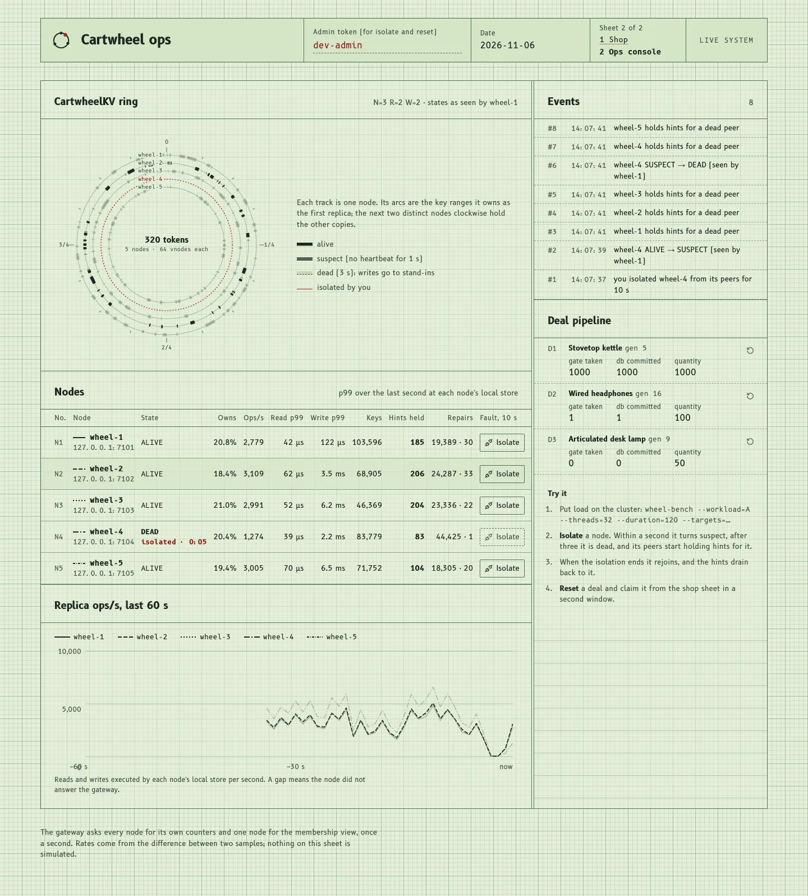
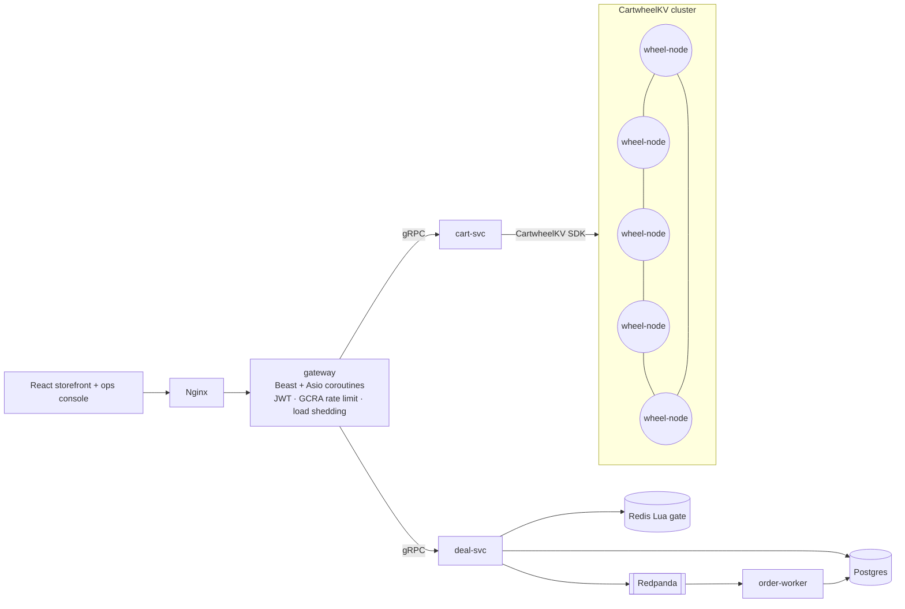

**English** | [中文](README.zh.md)

# Cartwheel

**A Dynamo-style distributed key-value store and a high-concurrency commerce stack, written in C++20.**

The 2007 Dynamo paper describes a shopping cart that must accept writes even
while servers fail and the network partitions. Cartwheel builds that system end
to end. **CartwheelKV** is a leaderless, quorum-replicated KV store with its own
LSM storage engine. On top of it run a shopping-cart service, a flash-sale
("lightning deal") pipeline that must never oversell, a C++ edge gateway, and a
React storefront with an operations console.

The cart and the deal inventory sit on opposite sides of the CAP trade-off, so
both models live in the same system:

| Data | Requirement | Mechanism |
|---|---|---|
| Shopping cart | Always writable, even during partitions (AP) | CartwheelKV: N/R/W quorum, sloppy quorum + hinted handoff, vector clocks, OR-Set CRDT merge |
| Deal inventory | Never oversell (CP) | Redis Lua atomic gate → Redpanda (Kafka) to absorb the spike → idempotent Postgres writes |



*The storefront after another writer changed the cart: the bracketed line came from the other window, nothing was overwritten. Real capture against the running stack.*



*The ops console during a fault: the visitor isolated wheel-4 (red), its peers declared it DEAD within 3 s and started holding hints, while wheel-bench keeps the other four nodes busy. Real capture.*

## Architecture



## Status

| Milestone | Scope | State |
|---|---|---|
| M0 | Toolchain, build system, overload primitives (GCRA limiter, jittered backoff, histogram, bounded pool), CI | ✅ |
| M1 | End-to-end skeleton: single node (DVV siblings), cart-svc (OR-Set CRDT), Beast/coroutine gateway, storefront, docker-compose | ✅ |
| M2 | LSM storage engine: WAL, group commit, skiplist memtable, SSTables + bloom, leveled compaction; SIGKILL/power-loss/fuzz tested; 62–92% of RocksDB | ✅ |
| M3 | Distribution: consistent hashing (64 vnodes), heartbeat gossip, N/R/W sloppy quorum, DVV siblings, hinted handoff, read repair, Merkle anti-entropy, per-table throttling; deterministic simulator with crashes/partitions; a node kill under load costs only its ~3.5 s detection window | ✅ |
| M4 | Lightning deals: atomic Redis Lua gate → idempotent Kafka/Redpanda log → batched Postgres commits with constraints of last resort; holds never released (redrive + sweeper); JWT, per-user GCRA, WebSocket push. 10k buyers / 1k units: sold out in 0.28 s, committed in 0.73 s, no oversell through worker kills and broker freezes | ✅ |
| M5 | Deal sheet (server-clock countdowns, live stock, claim, WebSocket-confirmed orders) and an ops console: per-node ring tracks, live ops/s and windowed p99, hints and repairs, one-click node isolation (a simulated partition), deal reset | ✅ |
| M6 | Observability: OpenTelemetry traces across every service (W3C traceparent over HTTP, gRPC and Kafka) into Jaeger; Prometheus metrics incl. cluster membership and hints; Grafana dashboard; symptom-based alerts with runbooks; k6 cart soak with a mid-run partition (0.04% errors) and deal spike (2,505 req/s, no oversell); [benchmarks](docs/benchmarks.md) | ✅ |
| M7 | Helm chart (wheel-node as a StatefulSet with per-pod DNS, PVCs and a PodDisruptionBudget), kind script, architecture, PRFAQ, runbooks | ✅ |

## Build

Prerequisites: CMake ≥ 3.25, Ninja, a C++20 compiler (Apple Clang 17 / Clang 18 / GCC 13), and
[vcpkg](https://github.com/microsoft/vcpkg) cloned to `~/vcpkg` or pointed to by `$VCPKG_ROOT`.

```bash
cmake --preset dev          # first run builds dependencies through vcpkg (gRPC takes a while)
cmake --build --preset dev
ctest --preset dev

cmake --preset tsan && cmake --build --preset tsan && ctest --preset tsan   # ThreadSanitizer
```

Presets: `dev` (Debug), `release` (RelWithDebInfo), `asan` (Address + UB), `tsan` (Thread).

## Run it

```bash
# local binaries (after the build above)
build/dev/src/kv/wheel-node &
CARTWHEEL_KV_TARGET=127.0.0.1:7100 build/dev/src/services/cart/cart-svc &
CARTWHEEL_CART_TARGET=127.0.0.1:7200 build/dev/src/gateway/gateway &
(cd web && pnpm install && pnpm dev)          # http://localhost:5173
scripts/e2e_smoke.sh http://127.0.0.1:8080    # idempotency, 20 concurrent adds, no resurrection

# or the whole stack in containers (Grafana :3000/d/cartwheel, Jaeger :16686)
docker compose -f deploy/compose/docker-compose.yml up -d --build   # http://localhost:8088

# or on Kubernetes (kind + the Helm chart in deploy/helm/cartwheel)
scripts/kind_up.sh                                                   # http://localhost:8088
```

The container paths (compose, kind) are validated with `docker compose config`, `helm lint` and
`helm template`. All measured results in the docs come from the native setup above; the images
have not yet been built and run end to end on the author's machine.

A five-node CartwheelKV cluster on localhost (N=3, R=2, W=2):

```bash
scripts/local_cluster.sh start                                   # wheel-1..5 on :7101-7105
build/release/src/tools/wheelctl -t 127.0.0.1:7101 ring          # members, ownership, hints, repairs
build/release/src/tools/wheelctl -t 127.0.0.1:7101 where carts ada
build/release/src/tools/wheel-bench --workload=A --threads=32 --duration=30 \
  --targets=127.0.0.1:7101,127.0.0.1:7102,127.0.0.1:7103,127.0.0.1:7104,127.0.0.1:7105 &
scripts/local_cluster.sh kill 3; sleep 10; scripts/local_cluster.sh restart 3   # watch the error column
```

The lightning-deal pipeline needs Postgres, Redis and Kafka. `scripts/local_infra.sh` runs them
natively (Homebrew) on ports that stay clear of other local stacks:

```bash
scripts/local_infra.sh start && eval "$(scripts/local_infra.sh env)"
build/release/src/services/deal/deal-svc &                 # or CARTWHEEL_DEAL_BACKEND=memory, no infra
build/release/src/services/order_worker/order-worker &
CARTWHEEL_NOTIFY_REDIS_URL=$CARTWHEEL_REDIS_URL CARTWHEEL_AUTH_ADMIN_TOKEN=dev-admin \
  build/release/src/gateway/gateway &
build/release/src/tools/deal-rush --gateway 127.0.0.1:8080 --users 10000 --quantity 1000 \
  --pg-url "$CARTWHEEL_POSTGRES_URL"                       # spike + invariant check
ctest --preset dev -L infra                                # integration tests against the real services
```

The ops console is at `/ops` (sheet 2 of the pad). Nodes accept isolation only with
`debug.fault_injection = true` (on in `local_cluster.sh` and docker-compose); the gateway needs
`ops.kv_nodes` and `auth.admin_token`.

In the storefront, **Race two writers** fires two adds at the same instant: the store keeps two DVV
siblings, and the cart shows "Merged 2 concurrent versions" with both items kept.

## Documentation

- [Architecture](docs/ARCHITECTURE.md): components, data paths, and where each guarantee comes from.
- [PRFAQ](docs/PRFAQ.md): the product framing, working backwards from the customer.
- [Illustrated guide](docs/illustrated/README.md): walks one request at a time through the
  system, using traces captured from real runs.
- [Benchmarks and failure experiments](docs/benchmarks.md)
- [Architecture decision records](docs/adr/)
- [Runbooks](docs/runbooks/README.md): one per alert.
