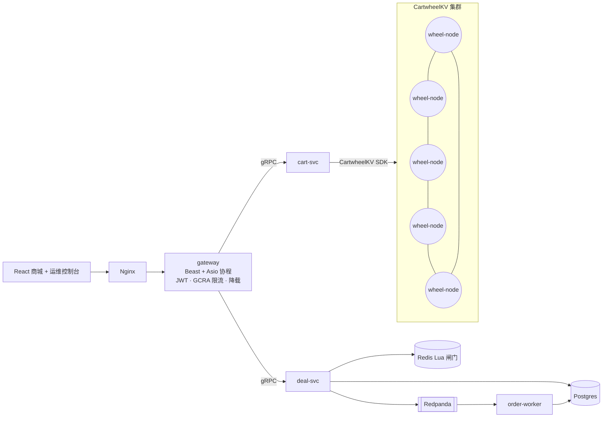

[English](README.md) | **中文**

# Cartwheel

**一个用 C++20 编写的 Dynamo 风格分布式 KV 存储，以及一套建在它上面的高并发电商系统。**

2007 年的 Dynamo 论文描述过这样一个购物车：即使服务器故障、网络分区，也必须能写入。Cartwheel 把这个系统完整做了出来。**CartwheelKV** 是一个无主（leaderless）的 KV 存储，用 quorum 做复制，存储引擎是自研的 LSM。在它之上有购物车服务、绝不超卖的秒杀（Lightning Deal）链路、C++ 边缘网关，以及 React 写的商城前端和运维控制台。

购物车和秒杀库存分别站在 CAP 取舍的两端，这两种一致性模型在同一个系统里同时存在：

| 数据 | 要求 | 实现方式 |
|---|---|---|
| 购物车 | 永远可写，分区期间也一样（AP） | CartwheelKV：N/R/W quorum、sloppy quorum + hinted handoff、vector clock、OR-Set CRDT 合并 |
| 秒杀库存 | 绝不超卖（CP） | Redis Lua 原子闸门 → Redpanda（Kafka）削峰 → 幂等写入 Postgres |

## 架构



## 进度

| 里程碑 | 内容 | 状态 |
|---|---|---|
| M0 | 工具链、构建系统、过载保护原语（GCRA 限流、jitter 退避、直方图、有界线程池）、CI | ✅ |
| M1 | 端到端骨架：单节点、网关、cart-svc、最简 UI、docker-compose | ⏳ |
| M2 | LSM 存储引擎（WAL、skiplist memtable、SSTable、布隆过滤器、compaction） | |
| M3 | 分布式：一致性哈希、gossip、quorum、vector clock、hinted handoff、Merkle 反熵、确定性仿真 | |
| M4 | 秒杀链路：Redis 闸门、Redpanda、order-worker、Postgres；网关鉴权与限流 | |
| M5 | 商城前端与运维控制台（哈希环、实时 QPS/p99、故障注入） | |
| M6 | 可观测性（Prometheus、Grafana、OpenTelemetry）、k6 压测、混沌实验 | |
| M7 | Helm/kind 部署、PRFAQ、runbook | |

## 构建

依赖：CMake ≥ 3.25、Ninja、支持 C++20 的编译器（Apple Clang 17 / Clang 18 / GCC 13），以及 [vcpkg](https://github.com/microsoft/vcpkg)（克隆到 `~/vcpkg`，或者用 `$VCPKG_ROOT` 指定位置）。

```bash
cmake --preset dev          # 第一次运行会通过 vcpkg 编译依赖，gRPC 比较慢
cmake --build --preset dev
ctest --preset dev

cmake --preset tsan && cmake --build --preset tsan && ctest --preset tsan   # ThreadSanitizer
```

Preset：`dev`（Debug）、`release`（RelWithDebInfo）、`asan`（Address + UB）、`tsan`（Thread）。

## 文档

- [图解](docs/illustrated/README.md)：每次跟着一个请求走完整个系统，所有数据都来自真实运行（英文）。
- [架构决策记录 ADR](docs/adr/)（英文）
