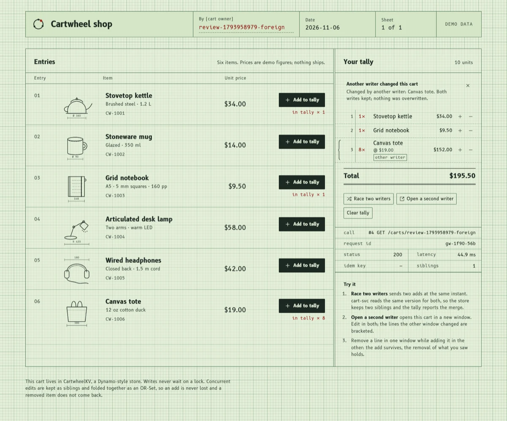
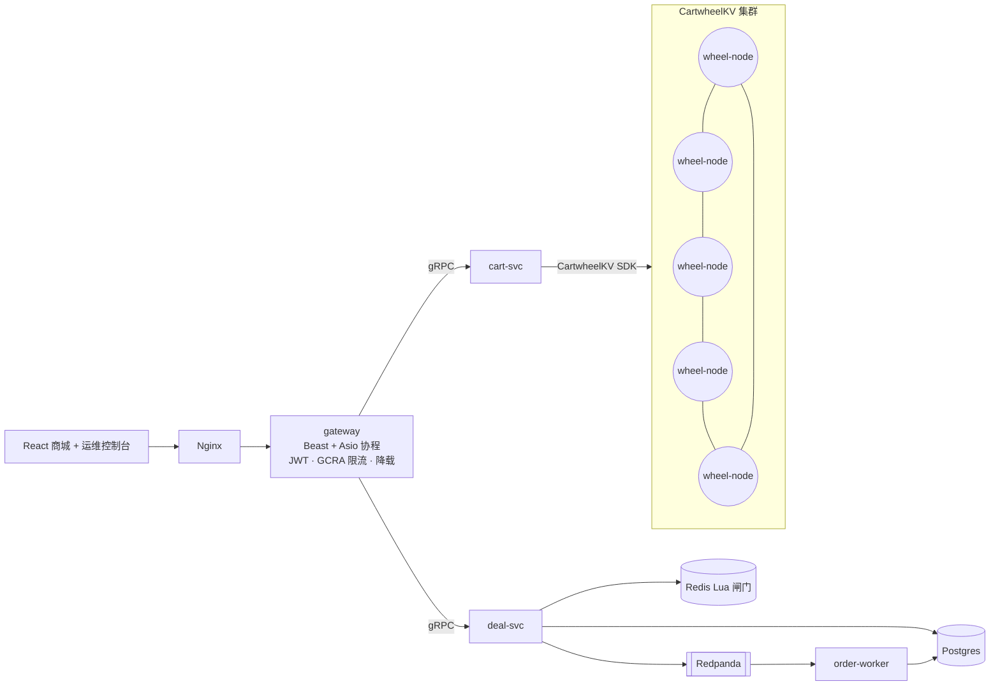

[English](README.md) | **中文**

# Cartwheel

**一个用 C++20 编写的 Dynamo 风格分布式 KV 存储，以及一套建在它上面的高并发电商系统。**

2007 年的 Dynamo 论文描述过这样一个购物车：即使服务器故障、网络分区，也必须能写入。Cartwheel 把这个系统完整做了出来。**CartwheelKV** 是一个无主（leaderless）的 KV 存储，用 quorum 做复制，存储引擎是自研的 LSM。在它之上有购物车服务、绝不超卖的秒杀（Lightning Deal）链路、C++ 边缘网关，以及 React 写的商城前端和运维控制台。

购物车和秒杀库存分别站在 CAP 取舍的两端，这两种一致性模型在同一个系统里同时存在：

| 数据 | 要求 | 实现方式 |
|---|---|---|
| 购物车 | 永远可写，分区期间也一样（AP） | CartwheelKV：N/R/W quorum、sloppy quorum + hinted handoff、vector clock、OR-Set CRDT 合并 |
| 秒杀库存 | 绝不超卖（CP） | Redis Lua 原子闸门 → Redpanda（Kafka）削峰 → 幂等写入 Postgres |



*另一个窗口改过购物车之后的商城页面：带括号标记的那一行来自另一个窗口，没有任何写入被覆盖。截图来自真实运行的服务。*

## 架构



## 进度

| 里程碑 | 内容 | 状态 |
|---|---|---|
| M0 | 工具链、构建系统、过载保护原语（GCRA 限流、jitter 退避、直方图、有界线程池）、CI | ✅ |
| M1 | 端到端骨架：单节点（DVV siblings）、cart-svc（OR-Set CRDT）、Beast + 协程网关、商城前端、docker-compose | ✅ |
| M2 | LSM 存储引擎：WAL、group commit、skiplist memtable、SSTable + 布隆过滤器、分层 compaction；通过 SIGKILL、断电、fuzz 测试；吞吐达到 RocksDB 的 62–92% | ✅ |
| M3 | 分布式：一致性哈希（64 vnode）、心跳 gossip、N/R/W sloppy quorum、DVV siblings、hinted handoff、read repair、Merkle 反熵、按表限流；带宕机和分区的确定性仿真；压测中 kill 一个节点，只在约 3.5 秒的故障检测窗口内报错 | ✅ |
| M4 | 秒杀链路：Redis Lua 原子闸门 → 幂等 Kafka/Redpanda 日志 → Postgres 批量提交（带兜底约束）；占位永不释放（重发队列 + 清扫器）；JWT、按用户 GCRA 限流、WebSocket 推送。1 万人抢 1000 件：0.28 秒卖光、0.73 秒全部落库，kill worker、冻结 broker 都不超卖 | ✅ |
| M5 | 秒杀单（按服务器时钟倒计时、实时库存、抢购、WebSocket 推送确认订单）和运维控制台：每节点一条环形轨道、实时 ops/s 与窗口 p99、hint 与修复计数、一键隔离节点（模拟网络分区）、重置秒杀 | ✅ |
| M6 | 可观测性（Prometheus、Grafana、OpenTelemetry）、k6 压测、混沌实验 | |
| M7 | Helm/kind 部署、PRFAQ、runbook | |

## 构建

依赖：CMake ≥ 3.25、Ninja、支持 C++20 的编译器（Apple Clang 17 / Clang 18 / GCC 13），以及 [vcpkg](https://github.com/microsoft/vcpkg)（克隆到 `~/vcpkg`，或者用 `$VCPKG_ROOT` 指定位置）。

```bash
cmake --preset dev          # 第一次运行会通过 vcpkg 编译依赖，gRPC 比较慢
cmake --build --preset dev
ctest --preset dev

cmake --preset tsan && cmake --build --preset tsan && ctest --preset tsan   # ThreadSanitizer
```

Preset：`dev`（Debug）、`release`（RelWithDebInfo）、`asan`（Address + UB）、`tsan`（Thread）。

## 运行

```bash
# 本地二进制（先按上面的步骤构建）
build/dev/src/kv/wheel-node &
CARTWHEEL_KV_TARGET=127.0.0.1:7100 build/dev/src/services/cart/cart-svc &
CARTWHEEL_CART_TARGET=127.0.0.1:7200 build/dev/src/gateway/gateway &
(cd web && pnpm install && pnpm dev)          # http://localhost:5173
scripts/e2e_smoke.sh http://127.0.0.1:8080    # 验证幂等、20 个并发加购、删除的商品不会复活

# 或者用容器跑整套服务
docker compose -f deploy/compose/docker-compose.yml up -d --build   # http://localhost:8088
```

在本机起一个 5 节点的 CartwheelKV 集群（N=3, R=2, W=2）：

```bash
scripts/local_cluster.sh start                                   # wheel-1..5，端口 7101-7105
build/release/src/tools/wheelctl -t 127.0.0.1:7101 ring          # 成员、环上占比、hint、修复计数
build/release/src/tools/wheelctl -t 127.0.0.1:7101 where carts ada
build/release/src/tools/wheel-bench --workload=A --threads=32 --duration=30 \
  --targets=127.0.0.1:7101,127.0.0.1:7102,127.0.0.1:7103,127.0.0.1:7104,127.0.0.1:7105 &
scripts/local_cluster.sh kill 3; sleep 10; scripts/local_cluster.sh restart 3   # 观察 errors 列
```

秒杀链路依赖 Postgres、Redis、Kafka。`scripts/local_infra.sh` 用 Homebrew 在本机直接启动它们，端口和其他本地项目错开：

```bash
scripts/local_infra.sh start && eval "$(scripts/local_infra.sh env)"
build/release/src/services/deal/deal-svc &                 # 或 CARTWHEEL_DEAL_BACKEND=memory，不需要外部依赖
build/release/src/services/order_worker/order-worker &
CARTWHEEL_NOTIFY_REDIS_URL=$CARTWHEEL_REDIS_URL CARTWHEEL_AUTH_ADMIN_TOKEN=dev-admin \
  build/release/src/gateway/gateway &
build/release/src/tools/deal-rush --gateway 127.0.0.1:8080 --users 10000 --quantity 1000 \
  --pg-url "$CARTWHEEL_POSTGRES_URL"                       # 瞬时抢购压测 + 不变量检查
ctest --preset dev -L infra                                # 连真实服务的集成测试
```

运维控制台在 `/ops`（稿纸第 2 页）。节点只有在 `debug.fault_injection = true` 时才接受隔离（`local_cluster.sh` 和 docker-compose 默认打开）；gateway 需要配置 `ops.kv_nodes` 和 `auth.admin_token`。

在商城页面里点 **Race two writers**，会同时发出两个加购请求。存储里会留下两个 DVV sibling，购物车显示 "Merged 2 concurrent versions"，两件商品都在。

## 文档

- [图解](docs/illustrated/README.md)：每次跟着一个请求走完整个系统，所有数据都来自真实运行（英文）。
- [架构决策记录 ADR](docs/adr/)（英文）
