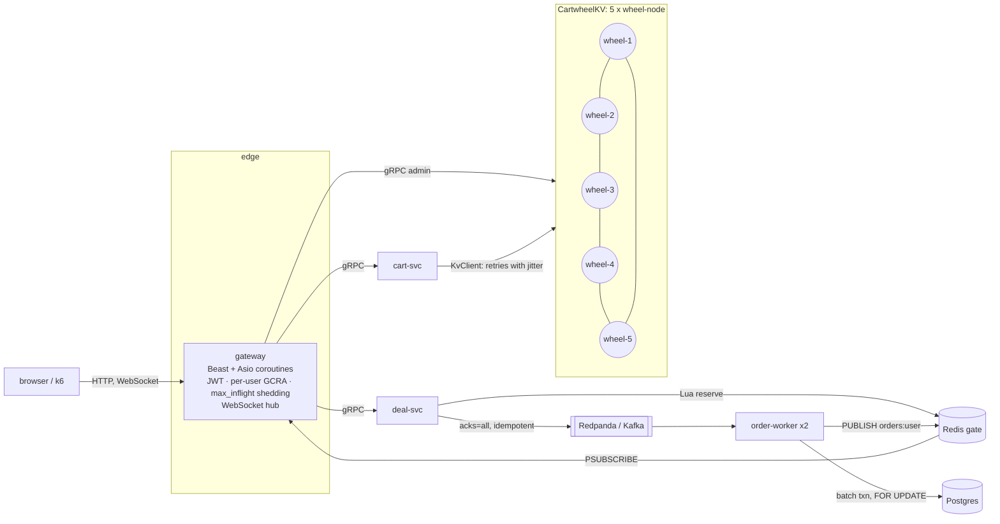

# Architecture

Cartwheel is two consistency models in one system. A shopping cart must accept writes during
failures (AP), and a lightning deal must never sell more than it has (CP). Each runs on the
storage that fits it, behind one C++ edge.

## Components

| component | language / libs | state | scales by |
|---|---|---|---|
| **wheel-node** | C++20, gRPC callback API, own LSM engine | its key ranges (LSM on disk) | adding nodes; consistent hashing moves about 1/N of the keys |
| **cart-svc** | C++20, gRPC, bounded worker pool | none | replicas |
| **deal-svc** | C++20, gRPC, redis++, librdkafka, libpqxx | none (the gate is in Redis) | replicas |
| **order-worker** | C++20, librdkafka consumer group, libpqxx | none (offsets in Kafka) | replicas up to the partition count |
| **gateway** | C++20, Boost.Beast/Asio C++20 coroutines, OpenSSL | none | replicas |
| **web** | React + TypeScript + Vite, served by Nginx | none | CDN |

## CartwheelKV (the AP store)

- **Storage.** Each node runs its own LSM engine:
  - WAL with group commit and masked CRC32C;
  - arena skiplist memtable;
  - SSTables with prefix-compressed blocks, bloom filters and a sharded LRU block cache;
  - leveled compaction with trivial moves and write stalls;
  - a MANIFEST with an atomic CURRENT.

  It reaches 62–92% of RocksDB on the same workloads (benchmarks.md). See ADR 0006 and
  illustrated/02.
- **Partitioning.** A consistent-hash ring with 64 virtual nodes per node. The preference list
  is the first N distinct nodes clockwise. See illustrated/03 §0.
- **Replication.** Leaderless N/R/W quorums (default 3/2/2). The coordinator writes locally and
  answers after W acknowledgements. Sloppy quorum and hinted handoff cover dead replicas; read
  repair and Merkle-tree anti-entropy cover everything else. See ADR 0007.
- **Versions.** Dotted version vectors keep concurrent writes as siblings, with no
  last-writer-wins (ADR 0004). The cart folds siblings as an OR-Set CRDT, so an add is never
  lost and a removed item does not come back (ADR 0005).
- **Membership.** Heartbeat gossip with incarnations. Each node judges liveness for itself
  (suspect after 1 s, dead after 3 s), and accusations are never gossiped.
- **Testability.** The cluster core depends only on Transport, Scheduler and Clock interfaces
  (ADR 0003). A seeded, deterministic simulator runs the production code through crashes,
  partitions and message loss, and checks that no acknowledged write is lost and that replicas
  converge.

## The lightning-deal pipeline (the CP path)

1. **Gate.** One Redis Lua script checks the user's hold, checks the stock, decrements, and
   records user → order id, atomically.
2. **Log.** The reservation is produced to Kafka/Redpanda with an idempotent producer and
   `acks=all`. The buyer gets 202 only after the broker acknowledges it.
3. **Holds are never released.** An unacknowledged publish is re-published (redrive queue),
   and a sweeper re-publishes any hold that has no stored order after 30 s.
4. **Commit.** order-worker commits up to 500 records per Postgres transaction. It locks the
   deal rows in id order, re-applies every rule (generation, one per customer, quantity), and
   is protected by `CHECK (sold <= quantity)` and a partial unique index. Offsets are committed
   after the database commit: delivery is at least once, the effect exactly once.
5. **Push.** The worker publishes each outcome on Redis. Gateways relay it to the buyer's
   WebSocket.

See ADR 0008 and illustrated/04, which also covers dead workers and frozen brokers.

## Cross-cutting

- **Overload.**
  - Every queue is bounded: worker pools answer `RESOURCE_EXHAUSTED` and the gateway sheds
    with 503 + `Retry-After` beyond `max_inflight`.
  - The gateway also applies per-user GCRA limits with 429.
  - Clients retry with full-jitter exponential backoff.
  - Catalog reads go through singleflight with serve-stale-on-error.
  - See illustrated/00 and /01.
- **Auth.** HS256 JWTs verified at the edge. WebSocket tokens travel in
  `Sec-WebSocket-Protocol` (ADR 0009).
- **Observability.**
  - Prometheus metrics on every process, including the cluster membership view and hint
    backlog.
  - OpenTelemetry traces across HTTP, gRPC and Kafka (W3C `traceparent`).
  - A Grafana dashboard, and symptom-based alerts with runbooks.
  - See illustrated/05.
- **Fault injection** (demo only). `debug.fault_injection` lets the ops console cut one node off
  from its peers. It is a real partition at the transport layer, not a simulated status.

## Deployment

| target | how |
|---|---|
| laptop, native | `scripts/local_cluster.sh`, `scripts/local_infra.sh`, `scripts/local_observability.sh` |
| laptop, containers | `deploy/compose/docker-compose.yml` (5 nodes, services, Postgres, Redis, Redpanda, Prometheus, Grafana, Jaeger) |
| Kubernetes | `deploy/helm/cartwheel`: wheel-node is a StatefulSet (stable ids, per-pod DNS for gossip, a PVC per node, PDB `maxUnavailable: 1`); `scripts/kind_up.sh` for kind |

## Where to read next

- [PRFAQ](PRFAQ.md): the product framing.
- [ADRs](adr/): every significant decision and what it costs.
- [Illustrated guide](illustrated/README.md): each mechanism, traced with real output.
- [Benchmarks](benchmarks.md) and [runbooks](runbooks/README.md).
