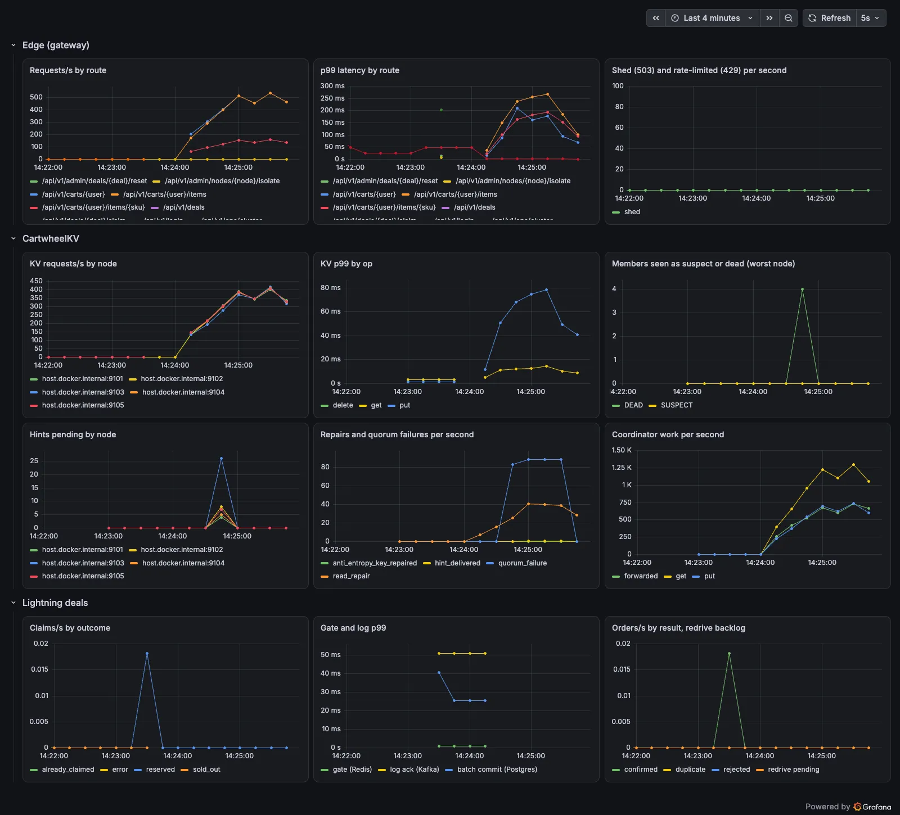

# Benchmarks and failure experiments

Every number on this page was measured on this repository's release build. Each row links the
chapter that shows the full output and how to reproduce it.

**Hardware and honesty.** All runs used one Apple M3 Pro laptop (12 cores, macOS 15, Apple
Clang 17). The load generator, every service and the infrastructure (Postgres 17, Redis 8,
Kafka 4 in KRaft mode) shared that machine. The laptop was also running other heavy work (a VM,
an Android emulator, Gradle and Rust builds; load average 15–40). So absolute throughput is a
floor, not a capacity claim. Comparisons made back to back in one session (Cartwheel vs RocksDB,
`max_inflight` 16 vs 2048, healthy vs faulted) are the meaningful part.

## Storage engine (single process, no network)

`lsm-bench` against RocksDB 11.12, using the same workloads and key and value sizes
([illustrated/02](illustrated/02-inside-the-lsm-engine.md)):

| workload | Cartwheel LSM | RocksDB | ratio | Cartwheel p99 | RocksDB p99 |
|---|---:|---:|---:|---:|---:|
| fillseq | 261,262 ops/s | 299,233 ops/s | 87% | 10.5 µs | 8.1 µs |
| fillrandom | 156,540 ops/s | 250,628 ops/s | 62% | 17.9 µs | 8.3 µs |
| overwrite | 179,935 ops/s | 194,666 ops/s | 92% | 8.5 µs | 17.5 µs |
| readrandom | 119,148 ops/s | 137,314 ops/s | 87% | 31.7 µs | 31.5 µs |
| readrandom, 4 threads | 542,460 ops/s | 750,204 ops/s | 72% | 48.1 µs | 36.4 µs |

The engine also survives SIGKILL every round with no acknowledged key lost, and survives simulated
power loss (unsynced writes dropped) back to its last synced point.

## HTTP edge, single node ([illustrated/01](illustrated/01-life-of-an-add-to-cart.md))

| run | result |
|---|---|
| cart reads, 64 clients (`ab -k`) | 22,246 req/s, p50 2 ms, p99 16 ms, 0 failures |
| 5,000 concurrent retries of one add, same idempotency key | 13,153 req/s; quantity stays 1 |
| 256 clients, `max_inflight=16` | 33,189 req/s answered, 74% shed with 503, p99 33 ms |
| 256 clients, `max_inflight=2048` | 20,053 req/s, nothing shed, p99 71 ms |

## Five-node CartwheelKV cluster ([illustrated/03](illustrated/03-life-of-a-put-on-the-ring.md))

YCSB workload A (50% reads, 50% read-modify-write), 32 threads, 50k zipfian keys, real gRPC
between five `wheel-node` processes, N = 3, R = W = 2:

| run | throughput | errors | latency |
|---|---|---|---|
| wheel-3 SIGKILLed at 10.3 s, restarted at 20.3 s | 7,451 ops/s over 34 s | 191 of 253,331 (0.075%), all within ~3.5 s of the kill | p50 2.36 ms, p99 34 ms |
| hint backlog after the restart | ~5.5k hints replayed in under 1 s | | |
| deterministic simulator, 5 seeds of crashes, partitions and 0–2% loss | invariants hold on every seed | | |

**k6 cart soak through a partition** (`deploy/k6/cart-soak.js`). 50 shoppers ran add, read and
remove for 90 s. At t = 30 s, k6 itself isolated wheel-3 from its peers for 15 s through the ops
API:

```
http_reqs......: 114,387   1,270 req/s
http_req_failed: 0.04%     52 of 114,387     (threshold < 1%: pass)
p50 7.5 ms   p95 55.9 ms   p99 138.6 ms      (threshold p99 < 500 ms: pass)
```

During the partition, the isolated node failed about 80 quorum operations per second on the
requests it coordinated. KvClient's jittered retries moved those requests to healthy nodes, so
only 52 surfaced to shoppers (see the dashboard below). The same load with no partition
(`-e NODE=none`) failed 0 of 55,454 requests. Its latency was worse (p99 337 ms), because the
laptop's load average had risen to 57 by then, so only the failure counts are comparable.

## Lightning deals ([illustrated/04](illustrated/04-life-of-a-lightning-deal.md))

| run | result |
|---|---|
| `deal-rush`: 10k buyers, 1k units, 256 connections | 14,767 claims/s; sold out in 0.28 s; all committed 0.73 s after opening; push p50 0.33 s; no oversell |
| same, one order-worker SIGKILLed 0.8 s before opening | 489 orders wait in Kafka for the 10 s session timeout, then commit; nothing lost |
| same, Kafka frozen for 5 s at the opening | 9,000 sold-out answers at p50 1 ms; 1,000 winners retry and get their order ids; all 1,000 committed once Kafka resumes |
| k6 spike: up to 1,500 new buyers/s, each login + claim, 2k units | 2,505 req/s; 2,000 reserved and committed, 35,624 sold out; claim p99 45 ms; 100% definite answers |

The k6 summary counts 409 (sold out) as `http_req_failed` because it is not 2xx. The script's own
`definite answer` check is the contract: 202, 200, 409, 429 or 503, never an error page.

## What one request costs (traces)

Traces from Jaeger, with every service exporting OTLP
([illustrated/05](illustrated/05-observing-the-system.md)):

```
add to cart     11.6 ms at the edge = 2 gRPC hops + KV get (1.4 ms at the node) + KV put (0.8 ms)
claim a deal    30.2 ms at the edge = Redis gate 0.76 ms + Kafka acks=all 27.9 ms;
                the batch commit in Postgres follows 7 ms later (26.5 ms, linked to the claim)
```


