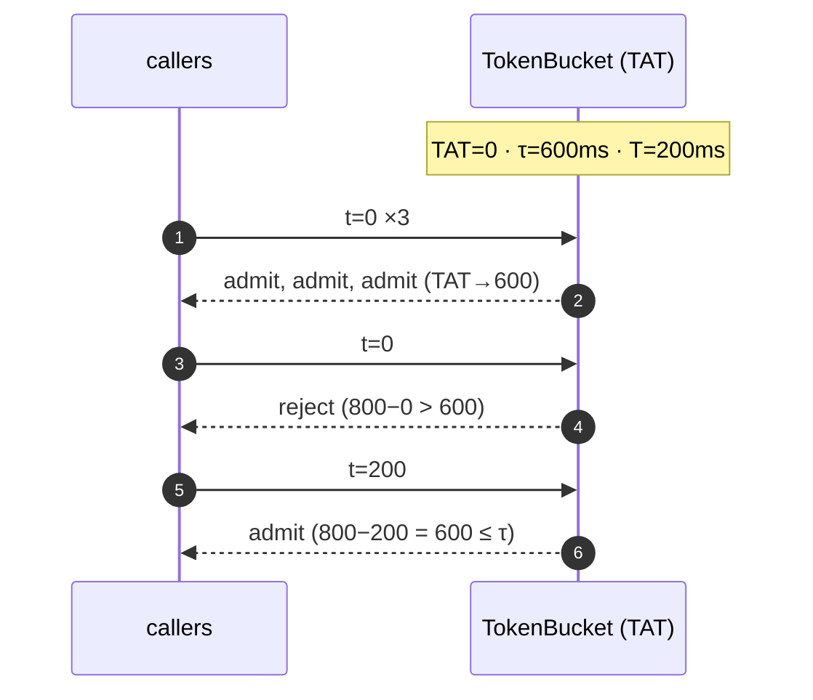
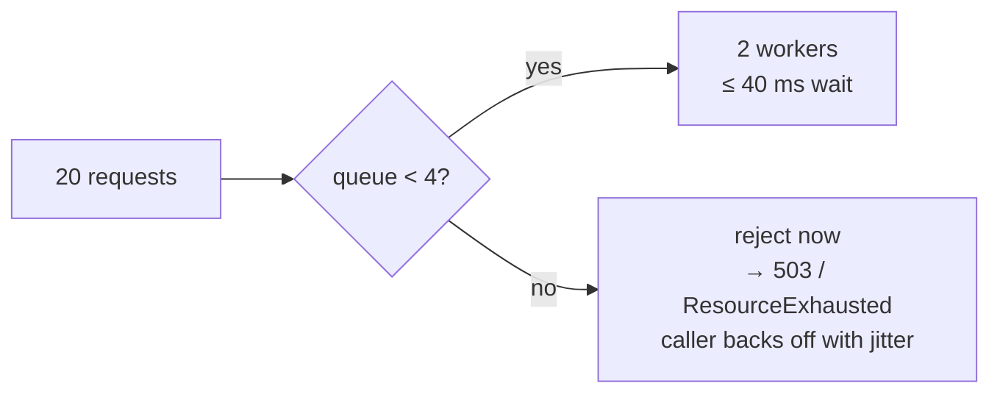

# 00 · The overload toolbox

> Every table in this chapter is real output from `build/release/src/tools/cw-tour` and
> `build/release/bench/common_bench` (Apple M3 Pro, macOS 15, Apple Clang 17, RelWithDebInfo).
> The tour runs on a `ManualClock` with fixed seeds, so its numbers are reproducible bit for bit.

A high-concurrency system mostly fails in one way. A burst arrives, queues grow,
latency climbs past client timeouts, clients retry, and the retries become the
next burst. Cartwheel defends against this with four small primitives in
`src/common/`, and every later chapter builds on them:

| Primitive | File | Used by (later milestones) |
|---|---|---|
| GCRA rate limiter | `token_bucket.{h,cc}` | gateway per-client limits (M4), per-table provisioned throughput in CartwheelKV (M3) |
| Jittered backoff | `backoff.{h,cc}` | `KvClient` retries (M1), hinted-handoff replay (M3), order-worker (M4) |
| Log-linear histogram | `histogram.{h,cc}` | `NodeStats` p50/p99 (M1), `wheel-bench` (M3), console charts (M5) |
| Bounded thread pool | `thread_pool.{h,cc}` | load shedding instead of unbounded queueing (M1+) |

---

## 1. GCRA: a token bucket stored in 8 bytes

A classic token bucket stores `tokens` and `last_refill` and needs a mutex to
update both together. GCRA (the Generic Cell Rate Algorithm, from ATM networks)
stores a single number: the **theoretical arrival time (TAT)**, the moment the
bucket would be full again if no more requests arrived.

```
  rate = 5/s   →  emission interval T = 200 ms   (time to refill one token)
  burst = 3    →  tolerance τ = 3·T = 600 ms      (how far TAT may run ahead of now)

  admit(now):  new_tat = max(TAT, now) + T
               admit  ⇔  new_tat − now ≤ τ        then CAS(TAT, new_tat)
```

Here is the real trace. Four requests arrive at t = 0, then more trickle in:

| t (ms) | TAT before | new TAT if admitted | new TAT − t | decision | tokens left |
|---:|---:|---:|---:|:---|---:|
| 0 | 0 | 200 | 200 | admit | 2.00 |
| 0 | 200 | 400 | 400 | admit | 1.00 |
| 0 | 400 | 600 | 600 | admit | 0.00 |
| 0 | 600 | 800 | 800 | **reject** | 0.00 |
| 100 | 600 | 800 | 700 | **reject** | 0.50 |
| 200 | 600 | 800 | 600 | admit | 0.00 |
| 250 | 800 | 1000 | 750 | **reject** | 0.25 |
| 900 | 800 | 1100 | 200 | admit | 2.00 |
| 900 | 1100 | 1300 | 400 | admit | 1.00 |

Reading the rows:

- **Rows 1–3, the burst.** Each admit pushes TAT 200 ms further ahead. After three admits,
  TAT − now = 600 ms = τ, so the bucket is empty.
- **Row 4, overflow.** Admitting would put TAT 800 ms ahead, past τ. The request is rejected
  and *TAT is unchanged*, because rejected requests cost nothing.
- **Row 5, half a token.** 100 ms have passed, which refills half a token. That is not
  enough, so this request is rejected too.
- **Row 6, exactly on time.** At t = 200 ms one full token has refilled
  (new TAT − t = 600 = τ), so the request is admitted.
- **Row 8, a long idle period.** `max(TAT, now)` discards the stale TAT. The bucket never
  holds more than `burst` tokens, however long it idles.



### A bug the tests caught: changing the rate

`SetRate()` lets an operator raise a table's provisioned throughput at runtime. The first
version only swapped T and τ. The test `SetRateTakesEffect` failed:

```
rate 1/s, burst 1 → acquire at t=0 → TAT = 1000 ms
SetRate(1000/s)   → T = 1 ms
t = 1 ms: new_tat − now = (1000 + 1) − 1 = 1000 ms ≫ τ = 10 ms → reject  ✗
```

TAT − now is a *deficit measured in time at the old rate*. One token's worth of debt at
1/s is 1 s, but at 1000/s it should be 1 ms. The fix rescales the backlog so that
**the deficit in tokens** is what carries over:

```cpp
backlog = max(0, TAT − now);
TAT     = now + backlog · T_new / T_old;      // CAS loop
```

`SetRatePreservesFillLevelInTokens` now pins this down. With 4 of 10 tokens left, a
10× rate increase still leaves 4 tokens, and 30 ms later there are 7.

### Lock-free does not mean contention-free

`common_bench`, median of 3 runs. Every thread hammers the limiter, at a rate high
enough that every call is admitted:

| threads | GCRA, one shared bucket | mutex bucket, shared | **GCRA, one bucket per thread** |
|---:|---:|---:|---:|
| 1 | 26.5 ns · 37.7 M/s | 35.4 ns · 28.3 M/s | 26.7 ns · 37.5 M/s |
| 2 | 128 ns · 15.6 M/s | 136 ns · 14.8 M/s | 26.8 ns · 74.6 M/s |
| 4 | 621 ns · 6.4 M/s | 335 ns · 11.9 M/s | 26.8 ns · 149 M/s |
| 8 | 1357 ns · 5.9 M/s | 811 ns · 9.9 M/s | 27.3 ns · **293 M/s** |

Three observations:

1. Uncontended, GCRA beats the mutex version by about 25%. About 20 ns of its 27 ns is
   `SystemClock::NowNanos()` itself (`BM_SystemClockNow` = 20.7 ns).
2. With 8 threads on **one** bucket, the CAS loop loses to the mutex. Every failed CAS
   bounces the same cache line between cores and retries. A mutex serializes waiters
   and causes fewer coherence transfers.
3. With **one bucket per thread**, throughput scales linearly to 293 M/s.

The design rule that follows, and is used throughout Cartwheel: **shard limiters by key**
(per client in the gateway, per table in CartwheelKV) and never put a single global bucket
on a hot path. Sharding is cheap because GCRA's only *mutable* state is one `int64` (the
TAT). The `TokenBucket` object is 32 bytes, since it also holds T, τ, and a clock pointer.
A per-client table whose clients share T and τ needs just 8 bytes per client, which is
8 MB per million clients.

---

## 2. Backoff with jitter: retries must not synchronize

Retries are necessary, but a fleet of clients that back off on the same schedule simply
moves the overload spike later. Delays for one client (base 10 ms, cap 2 s, seed 42):

| attempt | none | full | equal | decorrelated |
|---:|---:|---:|---:|---:|
| 1 | 10.0 ms | 8.9 ms | 5.7 ms | 10.7 ms |
| 2 | 20.0 ms | 0.7 ms | 10.7 ms | 31.3 ms |
| 3 | 40.0 ms | 31.5 ms | 26.5 ms | 16.5 ms |
| 4 | 80.0 ms | 54.1 ms | 60.3 ms | 30.3 ms |
| 5 | 160.0 ms | 137.6 ms | 89.2 ms | 19.2 ms |
| 6 | 320.0 ms | 271.4 ms | 290.2 ms | 57.4 ms |
| 7 | 640.0 ms | 506.1 ms | 366.1 ms | 140.2 ms |
| 8 | 1280.0 ms | 490.8 ms | 1201.6 ms | 353.9 ms |

The real test is a fleet. In this scenario, **1000 clients** all fail at t = 0 and each
retries 4 times (base 25 ms). The histograms below show when the 4000 retries reach the
server:

```
jitter=none          retries=4000  peak arrivals in any 1 ms = 1000
   25-50 ms  1000 ##################################################
   75-100ms  1000 ##################################################
  175-200ms  1000 ##################################################
  375-400ms  1000 ##################################################
              (every other 25 ms bucket: 0)

jitter=full          retries=4000  peak arrivals in any 1 ms = 71
    0-25 ms  1257 ##############################################################
   25-50 ms   636 ###############################
   50-75 ms   514 #########################
   75-100ms   326 ################
  100-125ms   307 ###############
  125-150ms   222 ###########
  150-175ms   174 ########
  175-200ms   131 ######
  200-225ms   133 ######
  225-250ms   100 #####
  250-275ms    78 ###
  275-300ms    76 ###
  300-325ms    36 #
  325-350ms    10

jitter=decorrelated  retries=4000  peak arrivals in any 1 ms = 33
   25-50 ms   468 #######################
   50-75 ms   611 ##############################
   75-100ms   194 #########
  100-125ms   252 ############
  ...         (spread evenly out past 400 ms)
```

The number that matters is the **peak in any single millisecond**: 1000 with no jitter,
71 with full jitter, and 33 with decorrelated jitter. With no jitter, all 1000 clients
retry in the same microsecond, four times over. A recovering server sees four perfectly
synchronized waves, each enough to overflow its accept queue again.

An honest caveat about the first chart: full jitter puts *more* retries in the first
25 ms bucket (1257), because its early delays are drawn from `[0, 25 ms)` and
`[0, 50 ms)`. Jitter does not reduce the total work (4000 retries in every mode). It
removes the **instantaneous** spike. `KvClient` uses full jitter. Hint replay in M3 will
use decorrelated jitter, because spreading load out matters more there than retrying
quickly.

---

## 3. A histogram that is accurate, lock-free, and fixed-size

Averages hide tail latency, and sorting every sample does not scale, so Cartwheel uses
an HdrHistogram-style **log-linear** layout:

```
value v < 256                    → its own bucket (exact)
v in [2^m, 2^(m+1)), m ≥ 8       → 128 equal sub-buckets per power of two
                                   bucket width = 2^(m−7)  ⇒  relative error ≤ 2^−7 = 0.78%
```

Real bucket assignments:

| value (ns) | bucket | range [lo, hi] | width | max rel. error |
|---:|---:|---|---:|---:|
| 7 | 7 | [7, 7] | 1 | 0.000% |
| 255 | 255 | [255, 255] | 1 | 0.000% |
| 256 | 256 | [256, 257] | 2 | 0.391% |
| 1000 | 506 | [1000, 1003] | 4 | 0.300% |
| 123456 | 1393 | [123392, 123903] | 512 | 0.414% |
| 1500000 | 1847 | [1499136, 1507327] | 8192 | 0.546% |
| 987654321 | 3051 | [985661440, 989855743] | 4194304 | 0.426% |

The structure is 4352 buckets (34 KiB of `atomic<uint64_t>`) covering 0 ns to about
18 minutes. Recording a value costs one bit-width computation and one relaxed
`fetch_add`.

Accuracy against exact percentiles, over 200k log-normal latencies with a median around
1 ms:

| percentile | exact (sorted) | histogram | error |
|---:|---:|---:|---:|
| p50 | 995.03us | 995.33us | +0.030% |
| p90 | 2.15ms | 2.16ms | +0.464% |
| p99 | 4.01ms | 4.01ms | +0.199% |
| p99.9 | 6.36ms | 6.39ms | +0.444% |
| p100 | 17.72ms | 17.72ms | +0.000% |

The p100 error is exactly zero because `Percentile()` clamps to the true min and max.
The unit test `PercentilesWithinOnePercentOfExact` enforces the ≤ 1% bound.

The cache-line effect from section 1 shows up again (`common_bench`, median of 3):

| threads | one shared histogram | one histogram per thread |
|---:|---:|---:|
| 1 | 2.88 ns | 2.89 ns |
| 2 | 89.8 ns | 2.89 ns |
| 4 | 309 ns | 3.02 ns |
| 8 | 683 ns | 3.50 ns (2.28 G records/s) |

A server records one sample per request into a shared histogram, which is cheap at
request rates. `wheel-bench` records millions of samples per second, so each worker
thread owns a histogram and they are merged with `HistogramSnapshot::Merge()` at the
end. The test `MergeEqualsCombinedRecording` proves that merging loses nothing.

---

## 4. A bounded queue: reject early, not late

The pool has 2 workers and a queue capacity of 4. Twenty 20 ms tasks are submitted with
`TrySubmit()` as fast as possible:

```
submission order (A=accepted, r=rejected): AAAArrrrrrrrrrrrrrrr
accepted=4 rejected=16 completed=4
worst-case queueing delay is bounded by queue/threads*task = 40 ms
```



An unbounded queue would have accepted all 20. The last task would then wait 180 ms,
which is longer than the client's deadline, so the server would do work nobody is
waiting for. A bounded queue turns overload into **fast, explicit rejections**. The
caller can retry elsewhere or later, using the jittered backoff from section 2. The
Builders' Library article "Avoiding insurmountable queue backlogs" makes the same
argument.

Run to run, the timeline can vary slightly (for example `AAAAAr…`), depending on whether
a worker dequeues a task before the loop finishes. The bound does not vary.

---

**Reproduce:**

```bash
cmake --preset release && cmake --build --preset release
build/release/src/tools/cw-tour
build/release/bench/common_bench --benchmark_min_time=0.5s --benchmark_repetitions=3 \
    --benchmark_report_aggregates_only=true
```
