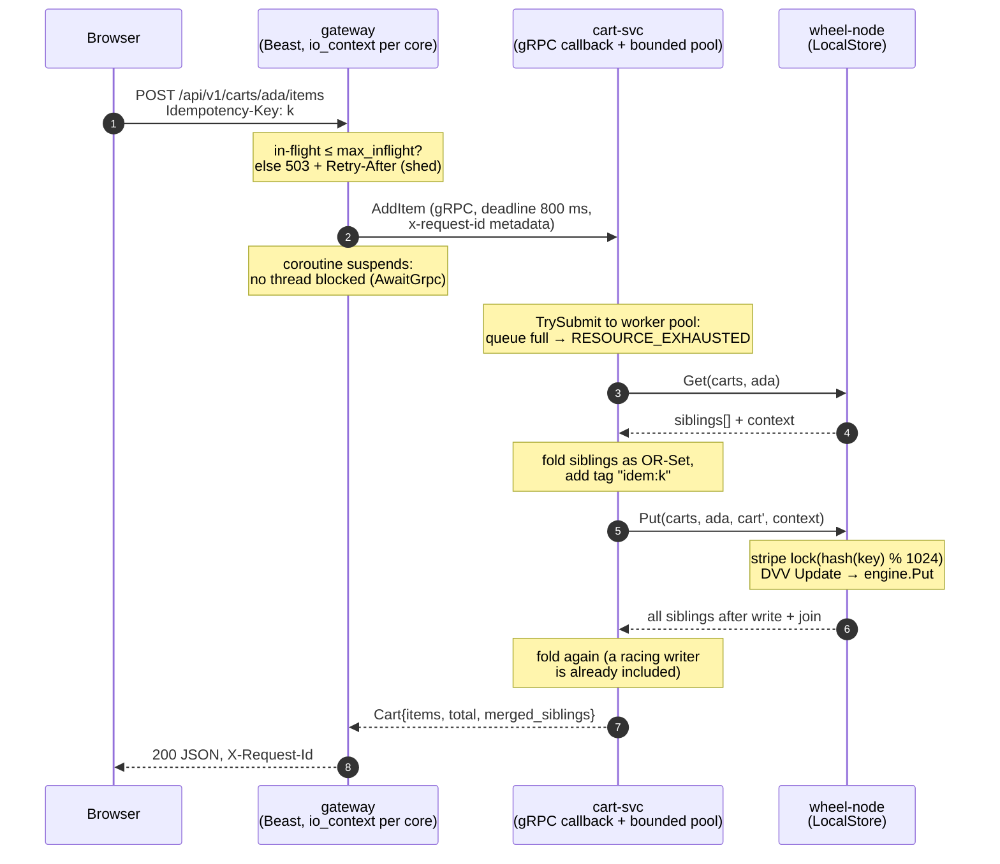
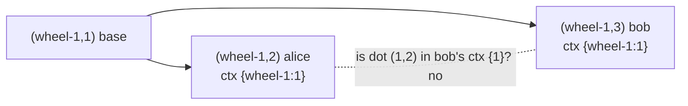

# 01 · Life of an add-to-cart

> This chapter follows one `POST /api/v1/carts/ada/items` from the browser to the bytes in the
> store and back. Every trace below is real output, either from the running M1 stack or from
> `build/dev/src/tools/cw-trace`, which runs the production DVV, LocalStore and CartStore code on a
> fixed scenario.

## The path



The diagram shows where each layer stops overload:

| Layer | Mechanism | Code |
|---|---|---|
| gateway | `max_inflight`. Past it, the request is answered with `503 Retry-After: 1` and does no further work | `src/gateway/http_server.cc` |
| gateway → cart-svc | A per-call deadline. The coroutine suspends instead of blocking a thread | `src/gateway/grpc_await.h` |
| cart-svc | A bounded worker pool. `TrySubmit` fails fast, and requests that expire while queued are skipped | `src/services/cart/cart_service.cc` |
| cart-svc → wheel-node | A 300 ms deadline per attempt, with full-jitter retries on retryable codes | `src/client/kv_client.cc` |
| wheel-node | Per-key stripe locks (1024 stripes). Different keys never wait on each other | `src/kv/local_store.cc` |

## 1. One real request

This is the release build on the M3 Pro, running wheel-node, cart-svc and gateway as three processes:

```
$ curl -si -X POST 127.0.0.1:8080/api/v1/carts/ada/items -H 'Idempotency-Key: 7c1d0e52' \
       -d '{"sku":"CW-1003","quantity":1,"unit_price_cents":950,"title":"Grid notebook"}'
HTTP/1.1 200 OK
Content-Type: application/json
Cache-Control: no-store
X-Request-Id: gw-1f90-3
Content-Length: 143

{"items":[{"quantity":1,"sku":"CW-1003","title":"Grid notebook","unit_price_cents":950}],"merged_siblings":1,"total_cents":950,"user_id":"ada"}
```

`X-Request-Id` was minted by the gateway, because the request did not carry one. The gateway also forwards
it to cart-svc as gRPC metadata. Here is what the store now holds, read directly from wheel-node
with `wheelctl`:

```
$ wheelctl --target 127.0.0.1:7100 get carts ada
sibling 1  clock={wheel-1:1}  written_at_ms=1793961929718  (53 bytes)
  0000  0a 33 0a 0d 69 64 65 6d 3a 37 63 31 64 30 65 35  |.3..idem:7c1d0e5|
  0010  32 12 07 43 57 2d 31 30 30 33 18 01 20 b6 07 2a  |2..CW-1003.. ..*|
  0020  0d 47 72 69 64 20 6e 6f 74 65 62 6f 6f 6b 30 f6  |.Grid notebook0.|
  0030  d7 da 83 9b 34                                   |....4|
context  {wheel-1:1}  (hex 0107776865656c2d3101)
```

The value is the cart's `CartState` protobuf, which wheel-node treats as opaque bytes:

| bytes | field | meaning |
|---|---|---|
| `0a 33` | `adds` (field 1, length 51) | one observed add |
| `0a 0d 69 64 65 6d 3a …` | `tag = "idem:7c1d0e52"` | derived from the Idempotency-Key, so a retry re-inserts the same tag |
| `12 07 43 57 2d …` | `sku = "CW-1003"` | |
| `18 01` | `quantity = 1` | |
| `20 b6 07` | `unit_price_cents = 950` | varint `0xb6 0x07` = 54 + 7·128 |
| `2a 0d 47 72 69 64 …` | `title = "Grid notebook"` | |
| `30 f6 d7 da 83 9b 34` | `added_at_ms` | wall time, for display only |

## 2. The sibling set, byte by byte

CartwheelKV stores a **SiblingSet** under each key. In this example the set holds a single write of
`"hello"` (from `cw-trace`):

```
[(wheel-1,1) ctx={} 'hello']   encoded = 25 bytes
  0000  01 01 07 77 68 65 65 6c 2d 31 01 00 00 80 b0 e7  |...wheel-1......|
  0010  b9 a5 33 05 68 65 6c 6c 6f                       |..3.hello|
```

| bytes | meaning |
|---|---|
| `01` | encoding version 1 |
| `01` | 1 sibling |
| `07 77 68 65 65 6c 2d 31` | dot node: length 7, `wheel-1` |
| `01` | dot counter = 1 |
| `00` | causal context: an empty vector clock (0 entries) |
| `00` | flags (bit 0 = tombstone) |
| `80 b0 e7 b9 a5 33` | `written_at_ms`, varint |
| `05 68 65 6c 6c 6f` | value: length 5, `hello` |

## 3. Why a "dot": two writers, one context

Two clients read the same version and both write through the same coordinator. This is real
output of the production `SiblingSet` and `VectorClock` code:

```
after base write:              [(wheel-1,1) ctx={} 'base']   join = {wheel-1:1}
alice writes with {wheel-1:1}: [(wheel-1,2) ctx={wheel-1:1} 'alice']
bob   writes with {wheel-1:1}: [(wheel-1,2) ctx={wheel-1:1} 'alice' | (wheel-1,3) ctx={wheel-1:1} 'bob']
join now = {wheel-1:3}  -> a reader sees 2 siblings

plain VV: alice={wheel-1:2} bob={wheel-1:3} -> Compare(bob, alice) = kAfter: bob 'descends' alice, so alice is DROPPED
```



Bob's context `{wheel-1:1}` does not contain Alice's dot `(wheel-1,2)`, so Alice survives as a sibling.
With plain per-node vector clocks, the coordinator would have given Bob `{wheel-1:3}`. That clock
*descends* Alice's `{wheel-1:2}`, so Alice's write would vanish. ADR 0004 records the decision.

## 4. Two tabs, one cart: the OR-Set fold

Tab A adds a mug. Tab B removes the kettle and adds two notebooks. Both started from the same read
(`cw-trace`, real `CartStore` + `LocalStore`):

```
both tabs read: 1 sibling, context = {wheel-1:1}
stored sibling set: 2 siblings
  dot (wheel-1,2) ctx={wheel-1:1}  adds=2 tombstoned tags=0  lines: 1xCW-1001 1xCW-1002
  dot (wheel-1,3) ctx={wheel-1:1}  adds=1 tombstoned tags=1  lines: 2xCW-1003
folded view (merged_siblings=2): 1xCW-1002 2xCW-1003  total=$33.00
```

The fold takes the union of adds, `{kettle, mug, notebook×2}`, and the union of removed tags,
`{kettle's tag}`. It keeps every add whose tag was not removed, which gives **mug + 2 notebooks**.
Tab A never saw the removal, but it cannot bring the kettle back. That is the "deleted items
resurface" problem from Dynamo §4.4, closed (ADR 0005). In the storefront, **Race two writers**
produces exactly this. The tally reports *Merged 2 concurrent versions*, and lines changed by
another window get a pencil bracket.

## 5. Under load (one node, laptop, release build)

`ab -k` (keep-alive). The client and the three services all run on the same M3 Pro, so these numbers
show how the stack behaves, not production capacity.

**Read path:** `GET /api/v1/carts/bench-read`, 64 concurrent clients, 100,000 requests:

```
Failed requests:        0
Requests per second:    22245.73 [#/sec] (mean)
  50%      2 ms
  90%      4 ms
  99%     16 ms
```

wheel-node's own view of the same run, from `wheelctl stats`: `gets=105006 p50=0.4us p99=8.5us`. The
store answers in microseconds. The milliseconds are spent in two gRPC hops and HTTP.

**Write path, one hot key:** 32 concurrent clients POST the same item to the same cart, all with the
same `Idempotency-Key`, 5,000 times:

```
Complete requests:      5000
Failed requests:        1359   (Connect: 0, Receive: 0, Length: 1359, Exceptions: 0)
Requests per second:    13153.43 [#/sec] (mean)
  50%      2 ms
  99%     13 ms
 100%     15 ms
quantity 1 merged_siblings 12
cartwheel_cart_requests_total{code="OK",op="add"} 10003
```

- **Quantity stays 1** after 5,000 concurrent retries of the same add. Idempotency holds under
  contention, with no deduplication table.
- The "failed" requests are only ab's `Length` check. Each response body includes the current sibling
  count, so lengths differ. cart-svc counted every add as `OK`.
- 12 siblings exist at the end. That is the number of writers still racing when the run ended. Each
  of them wrote without a lock, and the next read folds them all together.

**Overload:** 256 concurrent clients against a gateway with `max_inflight=16`, then the same load
against the default `max_inflight=2048`:

| gateway | served (200) | shed (503 + Retry-After) | req/s | p50 | p99 | max |
|---|---:|---:|---:|---:|---:|---:|
| `max_inflight=16` | 12,774 | 37,226 | 33,189 | 5 ms | 33 ms | 48 ms |
| `max_inflight=2048` | 50,000 | 0 | 20,053 | 9 ms | 71 ms | 131 ms |

`cartwheel_http_shed_total 37226` matches ab's non-2xx count exactly. A shed request costs almost
nothing, so the gateway answers *faster* overall (33k req/s) while it rejects 74%. The tail stays
bounded at 48 ms, against 131 ms when everything is admitted. Rejected callers retry with jitter,
as chapter 00 showed. M4 adds per-client GCRA limits in front of this. Shedding is the
last line of defense, not the policy.

---

**Reproduce:**

```bash
cmake --preset release && cmake --build --preset release
build/release/src/tools/cw-trace                       # sections 2–4
# start wheel-node, cart-svc, gateway from build/release (README → Run it), then:
scripts/e2e_smoke.sh http://127.0.0.1:8080
ab -k -c 64 -n 100000 http://127.0.0.1:8080/api/v1/carts/bench-read
```
