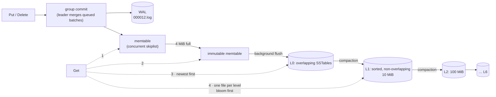

# 02 · Inside the LSM engine

> Every wheel-node stores its data in `src/storage/lsm/`, a leveled LSM tree written for Cartwheel
> (ADR 0006). The traces below are real output of `build/dev/src/tools/lsm-tour`, which drives the
> production code on fixed inputs. The tests and crash results come from `ctest` and
> `tests/crash/lsm_crash_test`.



## 1. A write, as WAL bytes

`WriteBatch{Put("cart:ada","v1"), Delete("cart:bob")}` committed at sequence 41 becomes 42 bytes on disk:

```
  0000  94 2c 74 fc 23 00 01 29 00 00 00 00 00 00 00 02  |.,t.#..)........|
  0010  00 00 00 01 08 63 61 72 74 3a 61 64 61 02 76 31  |.....cart:ada.v1|
  0020  00 08 63 61 72 74 3a 62 6f 62                    |..cart:bob|
```

| bytes | field |
|---|---|
| `94 2c 74 fc` | masked CRC-32C of type + payload. Unmasked it is `a0de2cf8`, and the reader recomputes the same `a0de2cf8` |
| `23 00` | payload length 35 |
| `01` | fragment type FULL (the record fits in the current 32 KiB block) |
| `29 00 00 00 00 00 00 00` | batch sequence 41 (fixed64 LE). The second record implicitly gets 42 |
| `02 00 00 00` | 2 records |
| `01` `08 cart:ada` `02 v1` | kValue, key, value |
| `00` `08 cart:bob` | kDeletion, key |

The CRC is *masked* (rotated plus a constant, as in LevelDB), so data that itself contains CRCs, such
as a WAL holding table bytes, can't produce degenerate checksums. A record larger than the rest of the
block is split into FIRST/MIDDLE/LAST fragments, so a corrupt byte costs at most one 32 KiB block.
`WalTest.CorruptionSkipsOnlyTheDamagedBlock` measures exactly that.

## 2. The memtable: a skiplist with one writer and lock-free readers

After 100,000 inserts, each level of the skiplist holds about 1/4 of the nodes below it
(`kBranching = 4`):

| level | nodes | ratio to level below |
|---:|---:|---:|
| 0 | 100000 | - |
| 1 | 24894 | 0.249 |
| 2 | 6076 | 0.244 |
| 3 | 1505 | 0.248 |
| 4 | 386 | 0.256 |
| 5 | 90 | 0.233 |
| 6 | 23 | 0.256 |
| 7 | 4 | 0.174 |
| 8 | 1 | 0.250 |
| 9 | 1 | 1.000 |

A search makes about `log₄(100000) ≈ 8.3` drops plus a few steps per level. That is O(log n) with
no rebalancing, which is why LevelDB and RocksDB use a skiplist and not a tree.

Concurrency works without locks:

- Only the group-commit leader inserts.
- A new node is fully built before a **release** store links it into its predecessor.
- Readers follow links with **acquire** loads, so they always see complete nodes.
- `SkipListTest.ConcurrentReadersSeeConsistentPrefix` runs 4 readers against a writer under TSan.

Nodes live in an arena, about 4.9 MiB for these 100k entries, and are freed all at once when the
flushed memtable dies. There is no per-entry malloc/free.

## 3. Anatomy of an SSTable

This table holds 2,000 keys `user:000000…user:001999` with 100-byte values. The file is 231,242 bytes:

```
[data block 0][trailer] … [data block 54][trailer] [bloom][trailer] [index][trailer] [footer 48 B]
 0             4193        226732                   226979           229485           231194
```

The footer is the last 48 bytes:

```
  0000  ed 80 0e a8 0d a3 ed 0d c5 13 00 00 00 00 00 00  |................|
  0010  00 00 00 00 00 00 00 00 00 00 00 00 00 00 00 00  |................|
  0020  00 00 00 00 00 00 00 00 43 41 52 54 57 48 4c 01  |........CARTWHL.|
```

`ed 80 0e` is varint 229485, the index offset, and `a8 0d` is its size, 1704. `a3 ed 0d c5 13` gives
the bloom filter's offset (226979) and size (2501). The final 8 bytes are the magic number: it is
stored little-endian, so on disk it reads `CARTWHL`, followed by format version 1.

The index has one entry per data block, mapping the block's **last** key to its handle. A seek for
key k takes the first index entry ≥ k, which is the only block that can hold k:

| block | last key in block | offset | size |
|---:|---|---:|---:|
| 0 | `user:000036 @seq 1036` | 0 | 4193 |
| 1 | `user:000073 @seq 1073` | 4198 | 4194 |
| 2 | `user:000110 @seq 1110` | 8397 | 4194 |
| … | | | |
| 54 | `user:001999 @seq 2999` | 226732 | 242 |

Each 4 KiB block starts like this:

```
  0000  00 13 64 75 73 65 72 3a 30 30 30 30 30 30 01 e8  |..duser:000000..|
  0010  03 00 00 00 00 00 61 61 61 61 61 61 61 61 61 61  |......aaaaaaaaaa|
```

| bytes | field |
|---|---|
| `00 13 64` | shared = 0 (restart point), unshared = 19, value length = 100 |
| `75 73 65 72 3a 30 30 30 30 30 30` | `user:000000` |
| `01 e8 03 00 00 00 00 00` | internal-key trailer: `seq << 8 \| type`, giving seq 1000 and type 1 (value) |

Each entry stores only the bytes that differ from the previous key. Every 16th entry is a **restart
point** that stores its key whole, and the restart offsets are listed at the block's end. A seek
binary-searches the restarts, then scans at most 16 entries.

Where the bytes go:

| part | bytes | share |
|---|---:|---:|
| data blocks + trailers | 226,979 | 98.2% |
| bloom filter | 2,501 | 10.0 bits/key, k = 6 |
| index | 1,709 | |
| footer | 48 | |
| **total vs raw key+value (222,000 B)** | **231,242** | **+4.2%** overhead, internal-key trailers included |

The bloom filter decides most misses without any IO. In `TableTest.PointLookupsScanAndCache`,
1,000 lookups for absent keys were answered by the filter in more than 950 cases, and
`BloomTest` measures the false-positive rate below 2% (10 bits/key; the theoretical rate is about
0.8%).

## 4. Flushes and compactions, as they happen

For this trace the limits are tiny (memtable 64 KiB, L1 target 256 KiB, files 64 KiB), so the tree
deepens fast. The workload is 60,000 puts over 20,000 keys, so every key is overwritten about 3
times, followed by 5,000 deletes. These events come from the `Options::event_listener` callback:

```
flush: memtable (673 entries) -> L0 #000005.sst 36.7 KiB   [L0:1 L1:0 L2:0 …]
flush: memtable (673 entries) -> L0 #000007.sst 36.7 KiB   [L0:2 L1:0 L2:0 …]
flush: memtable (673 entries) -> L0 #000009.sst 36.7 KiB   [L0:3 L1:0 L2:0 …]
flush: memtable (673 entries) -> L0 #000011.sst 36.7 KiB   [L0:4 L1:0 L2:0 …]
compaction: L0 (4 files) + L1 (0 files), 146.9 KiB in -> L1 (3 files) 145.5 KiB out;
            kept 2692 entries, dropped 0 shadowed versions and 0 tombstones   [L0:0 L1:3 L2:0 …]
flush: memtable (673 entries) -> L0 #000016.sst 36.7 KiB   [L0:1 L1:3 L2:0 …]
...
compaction: L1 (1 files) + L2 (4 files), 332.0 KiB in -> L2 (5 files) 308.7 KiB out;
            kept 5783 entries, dropped 426 shadowed versions and 0 tombstones   [L0:1 L1:5 L2:13 …]
compaction: L1 (1 files) + L2 (6 files), 407.4 KiB in -> L2 (6 files) 350.1 KiB out;
            kept 6558 entries, dropped 1065 shadowed versions and 0 tombstones  [L0:1 L1:5 L2:16 …]
compaction: L1 (1 files) + L2 (2 files), 199.9 KiB in -> L2 (2 files) 133.2 KiB out;
            kept 2496 entries, dropped 1248 shadowed versions and 0 tombstones  [L0:1 L1:5 L2:17 …]
... (162 events in total)
```

Reading the trace:

- **L0 → L1.** Four L0 files overlap, so all four are merged at once. The first merge drops
  nothing, because the first 2,692 puts all hit distinct keys (7919 is coprime with 20,000).
- **L1 → L2.** One L1 file merges with the L2 files that overlap it. As overwrites reach L2, the
  merge keeps only the newest version of each key, discarding up to 1,248 per run. Older versions
  that a running iterator still needs stay readable, because that iterator pins the old `Version`
  and its files (`LsmDbTest.IteratorIsASnapshot`).
- **Trivial moves.** When a file has nothing below it, it is re-linked one level down with no
  rewrite. This run made 6 of them.

After the run the tree is `L0:2 L1:4 L2:17`:

| level | files | bytes |
|---:|---:|---:|
| L0 | 2 | 22,213 |
| L1 | 4 | 240,343 |
| L2 | 17 | 1,093,074 |

```
user bytes 3,955,000 -> flushed 3,424,657 + compacted 17,933,518  => write amplification 6.40
```

**Write amplification of 6.4** is the price of a sorted, compact on-disk structure. Every user byte
is written once to the WAL, once at flush, and then rewritten as compaction pushes it down. With
these artificially tiny levels, each L1 → L2 merge rewrites several L2 files for one L1 file. In
return, reads touch at most one file per level, and space stays near the live data. Another 28,489
entries sit in tables for 15,000 live keys: older versions and tombstones in L2 that no compaction
has reached yet. More levels, or a compaction triggered by tombstone density, would reclaim them.

## 5. Group commit

Fsync is the dominant cost of a durable write. On macOS `F_FULLFSYNC` flushes the drive cache, at
roughly 6 ms per call. In group commit, the writer at the head of the queue becomes the leader: it
appends every queued batch as **one** WAL record, issues **one** fsync, and then wakes the others.

| threads | sync writes | WAL records (fsyncs) | writes per fsync | writes/s |
|---:|---:|---:|---:|---:|
| 1 | 300 | 300 | 1.0 | 161 |
| 8 | 2400 | 520 | 4.6 | 670 |

With 8 threads, each fsync carries 4.6 writes on average and throughput rises 4.2×. The leader
caps a group at 1 MiB, and at 128 KiB beyond its own batch when that batch is small, so a small
write never waits behind a huge one. A sync write is never folded into a non-sync leader's group,
which keeps durability from being weakened.

## 6. Crashes

Two kinds of crash, tested two ways:

| failure | what survives | test |
|---|---|---|
| **process killed** (`SIGKILL`, OOM) | the OS page cache survives, so every *acknowledged* write must survive, even with `sync=false` | `tests/crash/lsm_crash_test` |
| **power lost** | only bytes that were fsync'ed. Every write acknowledged with `sync=true`, plus everything before it in the WAL, must survive | `LsmDbTest.SyncedWritesSurvivePowerLoss`, using `FaultInjectionEnv`, which truncates every file to its last-synced size |

The SIGKILL test makes six rounds on one database. A child process writes and reports each acknowledged
key over a pipe, the parent kills it at a random moment, then reopens the database and checks every key:

```
round 0: 24037 keys acknowledged, all present after SIGKILL; L0:3 L1:3 L2:1 …
round 1: 59011 keys acknowledged, all present after SIGKILL; L0:0 L1:4 L2:7 …
round 2: 90684 keys acknowledged, all present after SIGKILL; L0:0 L1:4 L2:16 …
round 3: 112741 keys acknowledged, all present after SIGKILL; L0:3 L1:4 L2:20 …
round 4: 139717 keys acknowledged, all present after SIGKILL; L0:3 L1:5 L2:26 …
round 5: 153111 keys acknowledged, all present after SIGKILL; L0:3 L1:5 L2:30 …
```

The kills land in the middle of flushes and compactions. Recovery reads `CURRENT` → `MANIFEST`,
replays every WAL newer than the last flush, then flushes it. A torn record at the WAL tail is
recognised and ignored: it was never acknowledged, so dropping it is correct.

The same holds end to end. In this run the whole stack serves a cart, and wheel-node is `SIGKILL`ed
and restarted on the same directory while a request is already in flight:

```
lsm: recovered 1 WAL file(s), last_seq=25, L0:1 L1:0 L2:0 L3:0 L4:0 L5:0 L6:0
attempt 1: HTTP 200 in 0.532555s      <- waited for the node to come back
attempt 2: HTTP 200 in 0.001652s
{"items":[{"quantity":1,"sku":"CW-1004","title":"Articulated desk lamp",...}],"total_cents":5800,...}
```

The first version of this experiment returned `503 Unavailable` for about a second after every
restart. gRPC's default reconnect backoff starts at 1 s, and the client failed fast while the
channel was down. `KvClient` now sets `wait_for_ready` on every call, which waits for the channel
within the deadline, and lowers the reconnect backoff to 100 ms–2 s. Servers also set
`GRPC_ARG_ALLOW_REUSEPORT=0`. Without it, a second wheel-node on the same port silently shares
the socket and splits traffic, which is how the earlier failure stayed hidden.

Each metadata change is durable before anyone can observe it:

1. A new SSTable is fsync'ed.
2. The `VersionEdit` that adds it is appended to the MANIFEST and fsync'ed.
3. Only then is the new version installed and the old WAL deleted.

`CURRENT` is replaced via temp file + fsync + rename + directory fsync, so after a crash it points
at either the old MANIFEST or the new one, never at garbage.

## 7. Fuzzing the decoders

Every byte format the engine reads back is a fuzz target in `tests/fuzz/`: WAL records, blocks,
whole tables (footer, index, filter), MANIFEST edits, write batches, and sibling sets. CI runs them
under libFuzzer. Locally a replay driver runs 20,000 random and mutated inputs per target as part of
`ctest`, under ASan as well.

`block_fuzz` found a real bug in its first second. A corrupt restart offset larger than the
restart array made `restarts_ - offset` underflow into a huge length, and the iterator read out
of bounds (`SIGSEGV`). The fix validates every restart offset, and
`BlockTest.CorruptRestartOffsetIsCorruptionNotCrash` pins it as a regression test.

## 8. Against RocksDB

`lsm-bench` runs the same db_bench-style workloads against this engine and against RocksDB 11.12,
which vcpkg builds with `-DCARTWHEEL_BENCH_ROCKSDB=ON`. Both engines use the same settings: 4 MiB
memtable, 4 KiB blocks, 10-bit bloom filter, no compression, and a 32 MiB block cache. The run
uses 1,000,000 operations with 16-byte keys and 100-byte values, single-threaded unless noted, on
the release build and M3 Pro SSD.

| workload | Cartwheel LSM | RocksDB 11.12 | ratio | Cartwheel p99 | RocksDB p99 |
|---|---:|---:|---:|---:|---:|
| fillseq | 261,262 ops/s | 299,233 ops/s | 87% | 10.5 µs | 8.1 µs |
| fillrandom | 156,540 ops/s | 250,628 ops/s | **62%** | 17.9 µs | 8.3 µs |
| overwrite | 179,935 ops/s | 194,666 ops/s | 92% | 8.5 µs | 17.5 µs |
| readrandom | 119,148 ops/s | 137,314 ops/s | 87% | 31.7 µs | 31.5 µs |
| readmissing | 740,462 ops/s | 848,072 ops/s | 87% | 6.7 µs | 4.0 µs |
| readseq | 3,808,798 entries/s | 4,880,543 entries/s | 78% | | |
| readrandom, 4 threads | 542,460 ops/s | 750,204 ops/s | 72% | 48.1 µs | 36.4 µs |

```
Cartwheel after the run: L0:0 L1:5 L2:48 L3:12  size=129.5 MiB  write-amp=5.84
                         flushes=112 compactions=131 (trivial 64)  stall=131.2 ms
RocksDB after the run:   all 111 MiB in L6 (dynamic level sizing)
```

These numbers say three things.

- **Reads are close: 87% single-threaded.** Both engines do the same work per lookup: a bloom
  probe per candidate table, a binary search in the index, and one block. The gap is constant-factor
  work. RocksDB caches decoded index and filter blocks and uses a faster hash, while this engine
  copies values out.
- **Random fill is the big gap: 62%.** This engine runs flush and compaction on **one** background
  thread, while RocksDB ran two jobs. On random keys, L0→L1 compactions rewrite most of L1, so the
  single compaction thread falls behind. Writers then stall for 131 ms in total, which shows up as
  the 182 µs p99.9. Overwrite (92%) and sequential fill (87%) stay close because more of their
  compactions are trivial moves, 64 of the 131.
- **Space: 129.5 MiB against 111 MiB.** RocksDB's dynamic level sizing compacts everything into
  the last level. This engine still holds older versions in L2/L3 that no compaction has reached.

The obvious next steps, in order of payoff: run compactions on parallel threads for disjoint
levels, use dynamic level targets, cache index and filter blocks in the block cache with priority,
and add optional Snappy/ZSTD block compression. None of them change the format or the crash
protocol.


---

**Reproduce:**

```bash
build/dev/src/tools/lsm-tour
ctest --preset dev -R "Lsm|Wal|Table|Block|Bloom|SkipList|MemTable"
build/dev/tests/crash/lsm_crash_test
build/dev/tests/fuzz/block_fuzz 200000 7      # iterations, seed
```
