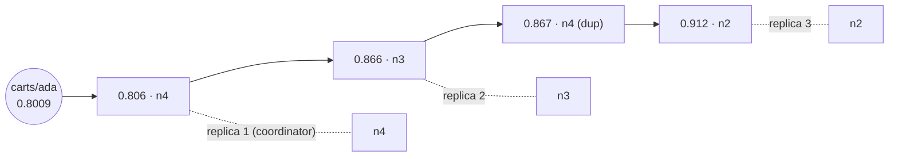
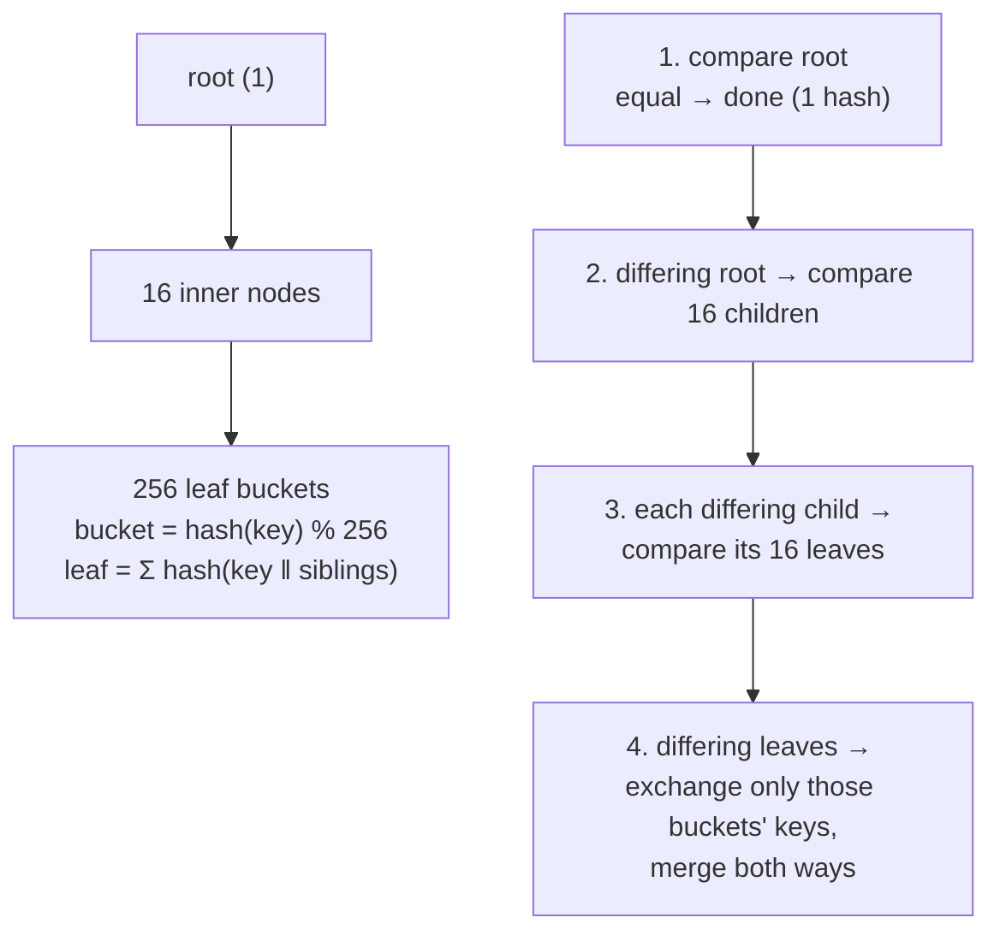

# 03 · Life of a PUT on the ring

> This chapter follows a write for `carts/ada` across a five-node CartwheelKV cluster (N = 3, R = 2, W = 2):
> forwarded, replicated, rerouted around a dead node, and handed back when the node returns.
>
> Sections 1–4 come from `build/dev/tests/sim/ring-tour`, which runs the production `ClusterNode` and
> `LocalStore` code inside the deterministic simulator; times are simulator milliseconds.
> Section 5 comes from five real `wheel-node` processes talking gRPC (`scripts/local_cluster.sh`)
> under `wheel-bench`.

## 0. Where the key lives

```
storage key "carts\0ada" -> RingHash 0xcd05869207b15b25 (0.8009 of the ring)
tokens clockwise from the key:
  0xce2b9cc6e064ea95  n4      <- first token at or after the key
  0xddb5f3866574ec09  n3
  0xddd5e3ff4797ae7c  n4      (n4 again: skipped, already chosen)
  0xe597cb05b54330ba  n4
  0xe8bb1c0904ecb868  n2
preference list (first 3 distinct nodes): n4 -> n3 -> n2
```



Each node owns several tokens, its **vnodes**, and the key's replicas are the first N *distinct*
nodes clockwise from the key. How many vnodes a node has decides how evenly the data is spread:

| vnodes per node | ownership range across 5 nodes (ideal 20%) | source |
|---:|---|---|
| 8 | 13.1% – 27.7% | ring-tour (simulated ring) |
| 64 | 18.4% – 21.0% | `wheelctl ring` on the real 5-node cluster |

`RingTest.AddingANodeMovesAboutOneSixthOfKeysAllToTheNewNode` shows that adding a sixth node moves
≈1/6 of the keys, and every moved key goes to the new node. That is the point of consistent
hashing: no reshuffle between existing nodes.

## 1. A PUT that arrives at the wrong node

The client's load balancer picked n1, which is not a replica, so n1 forwards the request. The coordinator
must itself be a replica, because a DVV dot (`(n4,1)` below) is minted against the coordinator's
local copy of the key (ADR 0004).

```
     0.000 ms  send  n1 -> n4  FORWARD_PUT
     1.832 ms  send  n4 -> n3  REPLICA_WRITE       n4 wrote locally, ships the full sibling set
     1.832 ms  send  n4 -> n2  REPLICA_WRITE
     4.128 ms  reply n3 -> n4  REPLICA_WRITE       2 of W=2 acks (n4 itself + n3)
     5.299 ms  reply n2 -> n4  REPLICA_WRITE
     6.211 ms  reply n4 -> n1  FORWARD_PUT
     6.211 ms  ACK   client <- coordinator: 2 acks, siblings [(n4,1) ctx={} 'kettle']

replicas after the write:
  n1  (nothing)
  n2  [(n4,1) ctx={} 'kettle']
  n3  [(n4,1) ctx={} 'kettle']
  n4  [(n4,1) ctx={} 'kettle']
  n5  (nothing)
```

## 2. A home replica dies: sloppy quorum and a hint

n3 crashes. After `dead_after` with no gossip heartbeat (0.9 s in this run, 3 s by default), the
other nodes route around it. The coordinator walks the ring past n3 and takes the next healthy
node, **n5**, as a stand-in. n5 stores the write and a **hint** recording that it belongs to n3.
The write still reaches W = 2 and succeeds:

```
PUT (context = previous write) while it is down:
     0.000 ms  send  n4 -> n2  REPLICA_WRITE
     0.000 ms  send  n4 -> n5  REPLICA_WRITE       hint_for = n3
     2.067 ms  reply n5 -> n4  REPLICA_WRITE
     2.067 ms  ACK   client <- coordinator: 2 acks, siblings [(n4,2) ctx={n4:1} 'kettle+mug']
     3.366 ms  reply n2 -> n4  REPLICA_WRITE       arrives after the ACK: never wait for the slowest

replicas while n3 is down:
  n2  [(n4,2) ctx={n4:1} 'kettle+mug']
  n3  [(n4,1) ctx={} 'kettle']                     stale: it was down
  n4  [(n4,2) ctx={n4:1} 'kettle+mug']
  n5  [(n4,2) ctx={n4:1} 'kettle+mug']   + 1 hint(s)
```

The new version `(n4,2)` has context `{n4:1}`. It supersedes `kettle` because the client had
read that version, not because it is newer in wall-clock time.

## 3. The node returns: hinted handoff

n3 restarts with a higher **incarnation**, so peers accept its reset heartbeat counter. Within one
gossip round it is ALIVE again. n5's hint loop finds a hint for a live node, replays it, and deletes it
once n3 has acknowledged:

```
   250.000 ms  send  n5 -> n3  REPLICA_WRITE
   254.127 ms  reply n3 -> n5  REPLICA_WRITE       hint deleted (only if unchanged meanwhile)

replicas after hinted handoff:
  n2  [(n4,2) ctx={n4:1} 'kettle+mug']
  n3  [(n4,2) ctx={n4:1} 'kettle+mug']             merged: (n4,1) is covered by ctx {n4:1}
  n4  [(n4,2) ctx={n4:1} 'kettle+mug']
  n5  [(n4,2) ctx={n4:1} 'kettle+mug']
```

n5 keeps its copy. It is harmless, because the next time n5 is a stand-in for this key, DVV merges make
the stale copy obsolete.

## 4. When hints are not enough: read repair and Merkle anti-entropy

Hints cover nodes that were briefly down. Two more mechanisms catch everything else, such as hints
lost when the stand-in itself died, or replicas that were partitioned:

- **Read repair.** A GET answers as soon as R replicas respond. It keeps listening, and once every
  replica has answered or timed out, it writes the merged set back to any replica that returned
  less.
- **Anti-entropy.** Every 2 s each node takes its next partition (round-robin), picks a peer
  replica, and compares a Merkle tree of that partition top-down:



One stale key costs 1 + 16 + 16 hash comparisons and one bucket of keys (`MerkleTest`). Comparing
a partition that is already in sync costs a single hash.

## 5. A real node failure under load

Five `wheel-node` processes run on localhost with the LSM engine and real gRPC, and `wheel-bench`
drives YCSB workload A: 50% reads, 50% read-modify-write updates, 32 threads, 50,000 zipfian keys.
At t = 10.3 s wheel-3 is `SIGKILL`ed, and at t = 20.3 s it is restarted:

```
t(s)     ops/s  errors       p50       p99
   9      4431       0    4.03ms   40.89ms
  10      4232       0    4.05ms   67.63ms
  11      3864      60    4.33ms   56.36ms     wheel-3 killed at 10.3 s
  12      2949      43    6.16ms   60.56ms     requests to it time out
  13      4568      66    2.59ms   59.51ms     (suspect after 1 s, dead after 3 s)
  14      9040      20    2.07ms   30.41ms     declared DEAD: sloppy quorum takes over
  15      8566       0    2.31ms   25.56ms
  ...                                         0 errors while it is down
  20      9918       0    2.13ms   20.84ms
  21      7947       1    2.31ms   27.26ms     wheel-3 restarted at 20.3 s
  22      6966       1    2.38ms   34.60ms
  ...                                         0 errors
total: 253331 ops in 34s = 7451 ops/s, 191 errors, p50 2.36ms p99 34.08ms p99.9 88.08ms
```

Hints on the four surviving nodes, sampled each second after the restart:

```
restart+1s: delivered=15677 pending=0      <- this run's ~5.5k new hints replayed in under a second
```

- **The cost of a failure is the detection window.** About 3.5 s passed between the kill and DEAD,
  and requests routed to wheel-3 in that window timed out. That was 189 errors, 0.07% of the run.
  After that, sloppy quorum made the dead node invisible to clients.
- **Recovery was invisible.** The restarted node rejoined through gossip, and the hint backlog
  drained in under a second.
- **Tuning.** A smaller `dead_after_ns` shrinks the error window but risks declaring slow nodes
  dead. Hedged reads, which send to R + 1 replicas, would hide most of the window for GETs.

The absolute throughput here comes from five nodes plus the load generator on one shared laptop
(load average ~35 from other work, see the README). It fluctuates between runs. The *shape* of
the timeline is the result.

## 6. Proving it: the deterministic simulator

`tests/sim/cluster_sim_test` runs 5 seeds. Each seed simulates 12 s of 6 clients doing random
reads and read-modify-writes on 40 hot keys, with faults: crashes, restarts, random partitions,
and 0–2% message loss. Then it heals the cluster and waits 15 s. Every seed must satisfy:

1. **No acknowledged write is lost.** Each write the client saw succeed is still a sibling, or a
   surviving sibling's causal context covers its dot (a later write read it).
2. **Convergence.** All 3 home replicas of every key hold byte-identical sibling sets.
3. **No hint is left behind** on any node.

A fourth test checks **determinism**: running seed 42 twice yields byte-identical final state
and message counts.

| seed | acked writes | failed (no quorum) | crashes | partitions | messages (dropped) | hint writes → entries handed off | read repairs | AE repaired keys |
|---:|---:|---:|---:|---:|---:|---:|---:|---:|
| 1 | 6,167 | 462 | 2 | 1 | 34,082 (3,260) | 489 → 48 | 288 | 19 |
| 2 | 5,811 | 762 | 3 | 2 | 32,016 (6,273) | 1,369 → 105 | 256 | 14 |
| 3 | 6,146 | 498 | 1 | 1 | 32,456 (2,812) | 2,177 → 67 | 344 | 9 |
| 4 | 5,701 | 953 | 2 | 2 | 30,542 (5,540) | 2,034 → 193 | 457 | 12 |
| 5 | 6,054 | 508 | 1 | 1 | 33,296 (3,318) | 1,841 → 78 | 338 | 6 |

All invariants held on every seed, and the same suite runs under ASan and TSan. "Failed" writes
are ones that did not reach W acks during a partition. The client was told so, which is correct
behaviour, not a violation. A failing seed prints
`CW_SIM_SEED=<n> ctest -R ClusterSim` to replay the exact run, message by message.

## 7. Known limits, stated plainly

- **Joins do not stream data.** A node that joins gets its ranges immediately, but the data
  arrives through read repair and anti-entropy rather than a bulk transfer. That is fine at demo
  scale, but production would stream partitions on join.
- **Anti-entropy rebuilds its tree with a full scan.** Trees are not maintained incrementally, so
  the cost grows with the node's data. A real system would update leaves on write or keep a
  per-partition tree.
- **Tombstones and stand-in copies are never garbage-collected.** They are correct but they grow.
- **Failure detection is heartbeat-based** (Cassandra-style), not SWIM's indirect probes, so a
  single slow link can make one observer suspect a healthy node. The impact is local, because
  accusations are never gossiped (ADR 0007).
