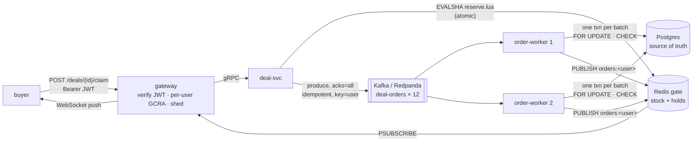

# 04 · Life of a lightning-deal purchase

> A thousand discounted headphones go on sale at one instant, and ten thousand buyers press the
> button. This chapter follows one purchase through the gate, the log, the worker and back to
> the buyer's browser. Then it breaks each piece in turn.
>
> Every number comes from the release binaries on one laptop: `deal-svc`, two `order-worker`s and
> the `gateway`, against native Postgres 17.11, Redis 8.10 and Kafka 4.4 (KRaft; the same protocol
> Redpanda speaks in docker-compose) from `scripts/local_infra.sh`. The load is `deal-rush`, a C++ client that talks to
> the real HTTP edge. The laptop was shared with other work (see the README), so treat absolute
> numbers as conservative.

## 0. Why this path is not like the cart

The cart (chapters 01 and 03) is **AP**. It must always accept a write, and concurrent versions are
merged later. A deal's inventory is the opposite: selling unit 1,001 of 1,000 is a real-world
failure that no merge can undo. So this path is **CP**, and every stage is built to say "no"
correctly:



| Stage | Answers in | Its job |
|---|---|---|
| Redis gate | ~1 ms | Say "sold out" to 9,000 people without touching anything else. |
| Kafka log | tens of ms | Make a reservation durable outside Redis and absorb the spike. |
| Postgres | batched | Be the truth. Re-check every rule under a row lock. |

## 1. Logging in: a token, not a session

`POST /api/v1/login {"user":"ada"}` returns an HS256 JWT. This one, decoded:

```
header : {"alg":"HS256","typ":"JWT"}
payload: {"exp":1793987700,"iat":1793984100,"iss":"cartwheel","sub":"ada"}
sig    : CFTK7ySN_2AxzY0T... (32 bytes HMAC-SHA256)
```

`JwtSigner::Verify` checks the signature *before* parsing anything, in constant time
(`CRYPTO_memcmp`). It accepts only `alg` HS256, so `"alg":"none"` and algorithm confusion are
rejected (`JwtTest.RejectsAlgNone`). It also requires `exp` and the issuer. The demo login has no
password; the rest of the stack only trusts the token, so a real identity provider would replace
this one route. A WebSocket cannot carry an `Authorization` header from a browser, so the push
channel takes the same token in `Sec-WebSocket-Protocol: cartwheel.v1, <jwt>`.

## 2. The gate: one Lua script

Each deal generation has two Redis keys that share a hash tag, `{dl-headphones}`. The tag puts
both keys in the same Redis Cluster slot, which a script requires. Their state right after a
sale:

```
deal:{dl-headphones}:12:stock   "0"                                   TTL 86190 s
deal:{dl-headphones}:12:holds   1001 fields
    rush0   -> ord_1a1b1c59834727071bd90134819
    :armed  -> 1      (marker: the hash exists and carries the TTL before the first sale;
                       ':' never appears in a user id)
```

Reserving is a single script (`redis_gate.cc`). Redis runs scripts one at a time, so check,
decrement and record are atomic without locks or `WATCH` retries:

```lua
local held = redis.call('HGET', KEYS[2], ARGV[1])
if held then return {'held', held, ...} end           -- retry: same order id back
local stock = redis.call('GET', KEYS[1])
if not stock then return {'unarmed', '', '0'} end     -- Redis lost it: re-arm from Postgres
if tonumber(stock) <= 0 then return {'soldout', '', '0'} end
local left = redis.call('DECR', KEYS[1])
redis.call('HSET', KEYS[2], ARGV[1], ARGV[2])         -- user -> order id
return {'reserved', ARGV[2], tostring(left)}
```

`RedisGate.ReservationIsAtomicUnderContention` runs 32 threads with 2,000 users against 200
units and gets exactly 200 reservations and 1,800 sold-out answers. Other cases:

- After a Redis restart, the script cache is empty and `EVALSHA` fails with `NOSCRIPT`. The gate
  reloads the script and retries once (`SurvivesScriptCacheFlush…`).
- If the stock key is missing (Redis was flushed or restarted without persistence), the script
  answers `unarmed`. deal-svc then re-arms it from Postgres with `quantity − sold`.
- The generation is part of the key. A reset creates fresh keys, and the old ones expire.

## 3. Into the log, and the rule that a hold is a promise

A reservation becomes an `OrderPlaced` record on topic `deal-orders`. The producer is idempotent
(`enable.idempotence`, `acks=all`). The record key is the user id, so a hot deal spreads over all
12 partitions while one user's records stay in order. Here are the two workers' assignments after
the runs below:

```
TOPIC        PARTITION  CURRENT-OFFSET  LOG-END-OFFSET  LAG  CONSUMER
deal-orders  0          967             967             0    order-worker-be1d3d07…
deal-orders  1          1184            1184            0    order-worker-be1d3d07…
  …                                                          (partitions 0-5)
deal-orders  6          873             873             0    order-worker-334ff972…
  …                                                          (partitions 6-11)
```

The buyer gets **202 RESERVED only after the log acknowledges the record**. The hard case is when
it does not:

| Publish outcome (librdkafka) | What it means | What deal-svc does |
|---|---|---|
| delivered | in the log | 202 RESERVED |
| failed (`NOT_PERSISTED`) | never written | **keep the hold**, re-publish, 503 "your unit is held, retry" |
| unknown (`POSSIBLY_PERSISTED`) | sent, ack lost | **keep the hold**, re-publish, 503 |

The first version released the unit on "failed" (a classic compensation), and `deal-rush` caught
the bug. The sequence was:

1. Kafka was frozen. A buyer's claim reserved a unit, its publish stalled, and the gateway answered
   504 after 800 ms.
2. The buyer retried and got `ALREADY_CLAIMED` plus their order id. The hold was real at that
   moment.
3. Three seconds later the first publish timed out as "failed", and compensation released the
   unit. The order id the buyer was holding now pointed at nothing.

The invariant check reported `order ids given=1664 of them committed=919 -> VIOLATED`.

The fix is to **never release a hold**. Every hold is turned into an order eventually, by two
mechanisms that only work because the consumer is idempotent:

- **`RedriveQueue`** re-publishes the same record, with the same order id, using backoff from
  100 ms up to 5 s, until the log acknowledges it. If both copies land, order-worker counts the
  second as a duplicate.
- **The hold sweeper** runs every 5 s. It compares each deal's holds (`HGETALL`) with the stored
  order ids, and re-publishes any hold older than 30 s that has none. This covers a deal-svc
  crash between Reserve and Publish, when the in-memory redrive queue is lost too.

## 4. The worker: at-least-once delivery, exactly-once effect

order-worker polls up to 500 records and commits them in **one transaction**. It commits the
Kafka offsets only after the transaction commits:

```sql
SELECT deal_id, generation, quantity, sold FROM deals
 WHERE deal_id = ANY($1) ORDER BY deal_id FOR UPDATE;      -- fixed lock order: no deadlocks
SELECT ... FROM orders WHERE order_id = ANY($1);           -- redelivered? -> duplicate
SELECT deal_id, generation, user_id FROM orders
 WHERE status = 'CONFIRMED' AND deal_id = ANY($1) AND user_id = ANY($2);
-- DecideBatch (C++, shared with the in-memory store), in log order:
--   unknown deal -> REJECTED   stale generation -> REJECTED
--   user already has one -> REJECTED   sold = quantity -> REJECTED   else CONFIRMED
INSERT INTO orders SELECT ... FROM unnest($1::text[], ..., $8::bigint[]) ON CONFLICT DO NOTHING;
UPDATE deals SET sold = $2 WHERE deal_id = $1;
COMMIT;                                                    -- then commitSync() the offsets
```

A crash at any point leads to a redelivery that the database already knows about. For example, if
the worker dies after COMMIT and before the offset commit, the same records come back and every
one is a duplicate. Duplicates are notified again, so a crash between COMMIT and PUBLISH cannot
swallow a push either (`DealPipeline.RedeliveryIsIdempotentAndRenotifies`).

The database does not trust the gate. Two schema rules hold even if every layer above them is
wrong:

```
deals.CONSTRAINT deals_never_oversold CHECK (sold >= 0 AND sold <= quantity)
UNIQUE INDEX orders_one_per_customer ON orders (deal_id, generation, user_id) WHERE status = 'CONFIRMED'

=# UPDATE deals SET sold = quantity + 1 WHERE deal_id = 'dl-headphones';
ERROR:  new row for relation "deals" violates check constraint "deals_never_oversold"
```

`DealPipeline.DatabaseBackstopsAGateThatLostItsData` simulates a Redis failover to a replica that
missed every write. Stock is full again and no holds remain, so six reservations race for three
units. Postgres confirms exactly three and rejects the rest, including a second order from the
same user.

## 5. Back to the buyer

After the commit, the worker sends `PUBLISH orders:<user> {order JSON}`. Each gateway holds one
`PSUBSCRIBE orders:*` and forwards the message to that user's WebSockets. Every connection is two
coroutines on its io_context thread: a reader, which also answers pings, and a writer fed by a
bounded queue. A client that falls 256 messages behind is disconnected instead of buffered.
Clients that miss a push still see the order through `GET /api/v1/orders`. That endpoint merges
committed orders from Postgres with holds still in flight, so a buyer sees PENDING immediately.

## 6. The spike

```
deal-rush --users 10000 --quantity 1000 --connections 256 --ws-sample 100 --pg-url ...

10000 claims over 256 connections in 677.21ms = 14767 claims/s
claim latency  p50 12.58ms  p90 21.89ms  p99 139.46ms  p99.9 168.50ms  max 168.50ms
outcomes:  RESERVED=1000  SOLD_OUT=9000
sold out after 278.79ms (last unit reserved); all orders committed after 732.00ms
claim -> CONFIRMED push (100 of 100 sampled buyers)  p50 331.35ms  p99 427.44ms

  ms since open   taken at the gate   committed in Postgres
        102              34                    0
        244            1000                    4
        451            1000                  726
        641            1000                 1000
invariant: quantity=1000 taken=1000 committed=1000 acknowledged(202)=1000 leaked=0 -> OK
```

The gate sold the deal out in under 0.3 s while the database was still on its first batches. That
gap is the spike being absorbed. The two workers caught up 0.7 s after the opening.

## 7. Breaking it

**A worker is SIGKILLed 0.8 s before the opening.** It cannot leave the group, so its six
partitions belong to nobody until `session.timeout.ms` (10 s) runs out:

```
outcomes:  RESERVED=1000  SOLD_OUT=9000          (buyers notice nothing)
     930 ms  taken  1000  committed   511         the survivor's partitions
    1909 ms  taken  1000  committed   511
    5110 ms  taken  1000  committed   511         the dead worker's 489 records wait in Kafka
    8818 ms  taken  1000  committed  1000         session expired, survivor took over, one batch
invariant: ... leaked=0 -> OK
```

**Kafka is frozen (`SIGSTOP`) for 5 s, starting 0.1 s before the opening.**

```
outcomes:  ALREADY_CLAIMED=1000  SOLD_OUT=9000   retries: 1000
claim latency  p50 978.94us  p90 4.15ms  p99 822.08ms
     211 ms  taken   256  committed     0         256 connections, each holding a unit and
    1019 ms  taken   483  committed     0         waiting until the gateway's 800 ms timeout
    3011 ms  taken  1000  committed     0
    5612 ms  taken  1000  committed  1000         Kafka back: 766 redriven publishes land
deal-svc: publish failed=749 unknown=17, redrives=766
invariant: ... order ids given=1000 of them committed=1000 stranded=0 -> OK
```

The 9,000 sold-out answers stayed at about 1 ms because the gate never waits for the log. Each
of the 1,000 winners got a 504 first. They retried with full-jitter backoff, and the retry
returned `ALREADY_CLAIMED` with their order id. Every one of those ids was committed once Kafka
returned.

**Kafka is frozen after the units were published.** In this case only the consumers stall:
`committed 956` holds for 5 s and jumps to 1000 when Kafka is resumed. The buyers had all
received 202 already.

**The bug the first run found.** The very first spike took 29 s to commit, and every push arrived
at the same moment. The broker log showed the cause:

```
Dynamic member ... joins group order-worker in Stable state ...
Stabilized group order-worker generation 9 with 2 members.        43 s later
member ... has failed, removing it from the group ... on heartbeat expiration
```

The restarted workers had called `KafkaConsumer::close()`, but librdkafka never sent LeaveGroup.
So every restart froze the partitions until the old members' sessions expired (45 s by default).
Now `~KafkaOrderSource` calls `unsubscribe()` before `close()`, and the broker logs
`explicit LeaveGroup request` with an immediate rebalance. A consumer that crashes is still
covered by `session.timeout.ms`, which was lowered to 10 s.

## 8. The edge keeps bots and bursts away

- **A per-user GCRA limit on claim** (1/s, burst 3) uses the same algorithm as chapter 00, with
  one 64-bit TAT per user in a 64-way sharded map. One user pressing claim eight times gets:

  ```
  409 409 409 429 429 429 429 429      (Retry-After: 1)
  cartwheel_gateway_rate_limited_total{route="claim"} 5
  ```

  The map is bounded: refilled buckets are evicted first, so a flood of fake ids cannot grow it
  (`KeyedLimiter.MemoryStaysBoundedUnderAKeyFlood`).
- **Load shedding** is the `max_inflight` 503 from chapter 01. Behind it, deal-svc's bounded pool
  answers `RESOURCE_EXHAUSTED` when its queue is full.
- **The catalog is behind singleflight.** At the opening every buyer loads the deal, and 32
  concurrent misses become one query (`Catalog.SingleflightCollapsesConcurrentMisses`). A failed
  reload keeps serving the previous snapshot.
- **One finding from tuning:** librdkafka leaves Nagle's algorithm on by default. Turning it off
  (`socket.nagle.disable=true`) cut the mean publish acknowledgement from 97 ms to 65 ms in the
  next run on the same, busy machine.

## 9. Known limits, stated plainly

- **Holds live in Redis.** A buyer who has an order id but whose record is not in the log yet
  depends on that hold. If Redis loses it (AOF is `everysec`) *and* deal-svc crashes before the
  redrive succeeds, the order is lost. Postgres still guarantees no oversell. A transactional
  outbox would close this gap, at the cost of a database write on the hot path.
- **The sweeper uses `HGETALL`.** That is fine for thousands of holds per deal; much larger deals
  would page through them with `HSCAN`.
- **Rate limits are per gateway instance.** With N gateways the effective limit is N times
  higher. A shared limiter (Redis GCRA) would make it global.
- **Every gateway receives every order event** (`PSUBSCRIBE orders:*`). That is fine for one
  region's demo traffic; at scale, gateways would subscribe per user shard.
- **`sold` in `GET /deals` can be up to `catalog.ttl_ms` (1 s) old.** `remaining` comes live from
  Redis.
- **The local stack runs one Kafka broker (rf = 1).** Production would use rf = 3 with
  `min.insync.replicas = 2`; the producer already uses `acks=all`.

Regenerate: `scripts/local_infra.sh start`, run deal-svc, two order-workers and the gateway from
`build/release`, then `build/release/src/tools/deal-rush --gateway 127.0.0.1:8090 --pg-url
"$CARTWHEEL_POSTGRES_URL"`. The faults use `kill -9 <order-worker>` and
`kill -STOP/-CONT <kafka java pid>`.
