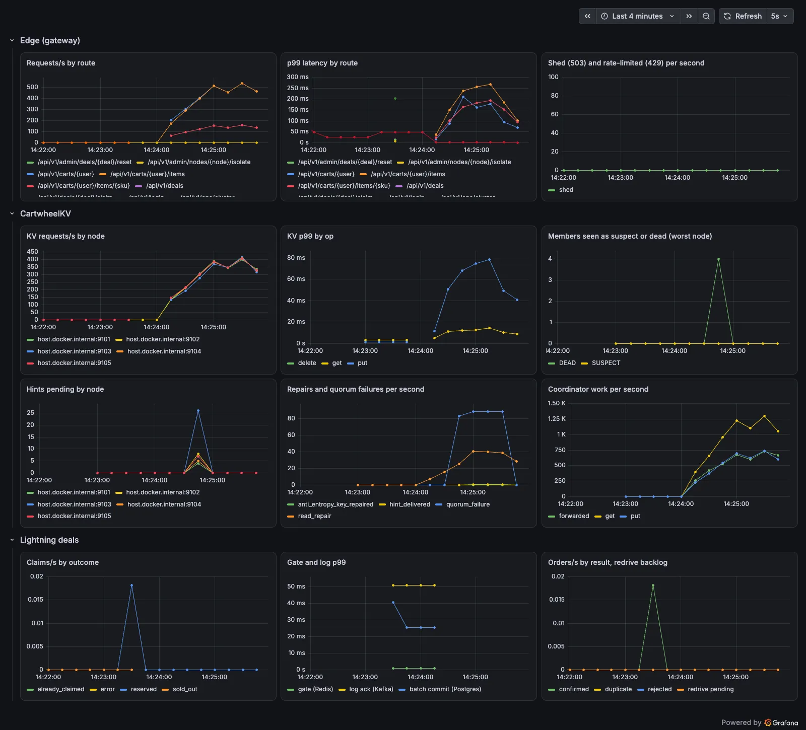

# 05 · Observing the system: traces, metrics, alerts, and load

> This chapter covers how Cartwheel explains itself while it runs. It shows a request as a trace
> across four services, the cluster on one dashboard, the alerts that would page someone, and
> two k6 runs that break things on purpose.
>
> Everything here was captured from the release binaries running natively, with Prometheus,
> Grafana and Jaeger in Docker (`scripts/local_observability.sh`). docker-compose runs the same
> configuration (`deploy/observability/`).

## 1. One trace across four services

Every service calls `tracing::Init(service, tracing.otlp_endpoint)`. With no endpoint set, each
span is a null object and costs a pointer check. Context travels as a W3C `traceparent` string in
four places:

| hop | carrier |
|---|---|
| browser or k6 → gateway | HTTP header (the gateway starts a trace when there is none, and returns `X-Trace-Id`) |
| gateway → cart-svc / deal-svc → wheel-node | gRPC metadata |
| inside cart-svc / deal-svc worker threads | `tracing::ScopedParent` (thread-local), so `KvClient` needs no new parameter |
| deal-svc → order-worker | a `traceparent` field in the `OrderPlaced` record in Kafka |

**An add to cart.** The gateway answered with `X-Trace-Id: accba655…`. Jaeger returned this
span tree:

```
  start     duration
  0.00 ms   11.61 ms  gateway: POST /api/v1/carts/{user}/items        [status_code=200]
  0.13 ms   11.39 ms    gateway: rpc /api/v1/carts/{user}/items
  4.66 ms    6.56 ms      cart-svc: CartService/add
  4.72 ms    4.88 ms        cart-svc: kv get                         [attempts=1]
  6.39 ms    1.39 ms          wheel-node: KvService/get              [replicas_responded=2 siblings=0]
  9.65 ms    1.56 ms        cart-svc: kv put                         [attempts=1]
 10.26 ms    0.80 ms          wheel-node: KvService/put              [replicas_acked=2]
```

The quorum get takes 1.4 ms on the coordinator, but 4.9 ms as cart-svc sees it. The gap is the
first call on that gRPC channel, plus 4.5 ms between the gateway sending and cart-svc starting.
The trace points to connection and queueing time, not the store, which is the question an
operator would ask first.

**A deal claim.** This trace continues past the response, into the asynchronous commit:

```
  0.00 ms   30.21 ms  gateway: POST /api/v1/deals/{deal}/claim         [status_code=202]
  0.04 ms   30.12 ms    gateway: rpc /api/v1/deals/{deal}/claim
  0.35 ms   29.35 ms      deal-svc: DealService/claim
  1.07 ms    0.76 ms        deal-svc: gate.reserve (redis lua)       [gate=reserved]
  1.82 ms   27.86 ms        deal-svc: deal-orders publish            [order_id=ord_1a1b2f…]
 37.50 ms   26.52 ms  order-worker: order batch commit (postgres)      [batch_size=1 confirmed=1]
```

- The atomic Redis gate costs 0.76 ms. Almost all of the claim latency is the broker's `acks=all`
  acknowledgement, which is the price of making the reservation durable before answering 202.
- order-worker's batch span is a child of the first claim in its batch. It also links up to 64
  claims (OpenTelemetry span links), so a spike's batch of 500 shows which claims it committed
  without 500 copies of the commit span.

## 2. Metrics and the dashboard

Each service exposes Prometheus metrics: wheel-node on `:910x`, cart-svc `:9200`, deal-svc
`:9300`, order-worker `:940x`, and the gateway on `/metrics`. The cluster view
(`cartwheel_cluster_members{state}`, `cartwheel_cluster_hints_pending`,
`cartwheel_cluster_events_total{kind}`) is sampled from each node's `ClusterNode::Stats()` once a
second. Counters advance by the delta between samples, so `rate()` works.



The dashboard (`deploy/observability/grafana/dashboards/cartwheel.json`) has three rows: the edge,
CartwheelKV and lightning deals. In the capture above you can see the partition from §4:

- One node's failure detector reports four peers as dead. That is wheel-3 looking out from inside
  its partition.
- Hints pending jump on every peer and drain to zero within a sample of the heal.
- About 85 quorum failures per second come from the isolated node.
- The edge's error rate barely moves.

## 3. Alerts that name a symptom and a runbook

`deploy/observability/alerts.yml`:

| alert | expression (abridged) | for | runbook |
|---|---|---|---|
| CartwheelNodeDown | `up{job="wheel-node"} == 0` | 30s | node-down |
| CartwheelMemberNotAlive | `max(cartwheel_cluster_members{state=~"SUSPECT\|DEAD"}) > 0` | 1m | node-down |
| CartwheelHintBacklog | `sum(cartwheel_cluster_hints_pending) > 1000` | 5m | hint-backlog |
| CartwheelQuorumFailures | quorum failures > 1/s | 2m | quorum-failures |
| CartwheelGatewayP99High | edge p99 > 250 ms | 5m | latency |
| CartwheelGatewayShedding | any 503 shedding | 2m | latency |
| CartwheelDealRedriveStuck | `max(cartwheel_deal_redrive_pending) > 0` | 2m | deal-pipeline |
| CartwheelOrderCommitFailing | batch commit failures | 5m | deal-pipeline |

Alerts fire on what a customer would feel, such as quorum failures, edge latency and
reservations not reaching the log, rather than on CPU. Each one carries a `runbook_url`.
Isolating wheel-5 for 90 s produced this timeline (Prometheus `/api/v1/alerts`, sampled every 5 s):

```
t=15s (none)
t=20s CartwheelMemberNotAlive pending
t=70s CartwheelMemberNotAlive pending
t=75s CartwheelMemberNotAlive FIRING
t=100s CartwheelMemberNotAlive FIRING
t=105s (none)
(wheel-5 isolated at t=0 for 90 s; `for: 1m` holds the alert pending before it fires,
 so a brief blip does not page anyone)
```

## 4. Load with faults: k6

**Carts through a partition** (`deploy/k6/cart-soak.js`). 50 shoppers run add, read and remove
for 90 s, and a second scenario isolates wheel-3 for 15 s at t = 30 s:

```
http_reqs......: 114,387   1,270 req/s
checks.........: 99.95%    (52 failed: add 33, get 14, remove 5)
http_req_failed: 0.04%     threshold < 1%      ✓
p50 7.5 ms   p95 55.9 ms   p99 138.6 ms        threshold p99 < 500 ms ✓
```

The same script with `-e NODE=none` (no partition), run right afterwards, failed 0 of 55,454
requests. So the 52 failures are the partition's cost. The isolated node kept accepting requests
it could no longer coordinate. Those failed (the dashboard's ~85 quorum failures/s), KvClient
retried them with jitter on other nodes, and only calls that ran out of retry budget surfaced.

The control run was also *slower* (615 req/s, p99 337 ms), because other work on the laptop was
heavier at that moment. Its latency is not comparable, and is shown only so the failure count
can be compared.

**A deal spike** (`deploy/k6/deal-spike.js`). Arrivals ramp to 1,500 new buyers per second in
5 s and hold for 20 s. Each buyer logs in and claims once, against 2,000 units:

```
deal_reserved..: 2,000            deal_sold_out: 35,624
http_reqs......: 75,250   2,505 req/s
claim p50 0.41 ms   p95 6.4 ms   p99 45.1 ms   threshold p99 < 300 ms ✓
definite answer: 100%                           threshold > 99.9%      ✓
teardown: quantity 2000, taken at the gate 2000, committed 2000
```

The sold-out answers cost almost nothing (median 0.41 ms for all claims), because the gate
answers them without the log or the database.

## 5. Limits

- **Every span is kept** (no sampling). That is fine for a demo; at scale a parent-based ratio
  sampler, or tail sampling in a collector, would keep the error and slow traces.
- **The per-batch commit span links at most 64 claims.**
- **Windowed p99 on the nodes is per second at the local store.** End-to-end latency comes from
  the gateway histogram and the traces.
- **Locally everything shares one laptop, including Prometheus and the load generator.** The
  numbers here describe behaviour under faults, not capacity.

Regenerate:

```bash
scripts/local_observability.sh start && export CARTWHEEL_TRACING_OTLP_ENDPOINT=127.0.0.1:24317
# start the services (README), then:
k6 run -e BASE=http://127.0.0.1:8090 deploy/k6/cart-soak.js
k6 run -e BASE=http://127.0.0.1:8090 -e QUANTITY=2000 deploy/k6/deal-spike.js
```
